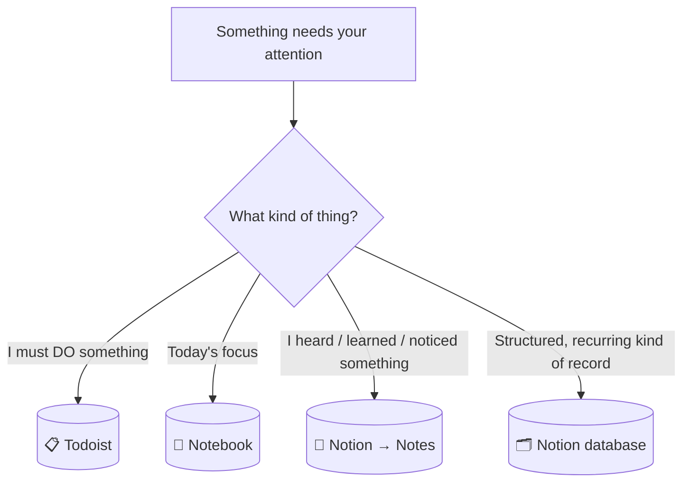
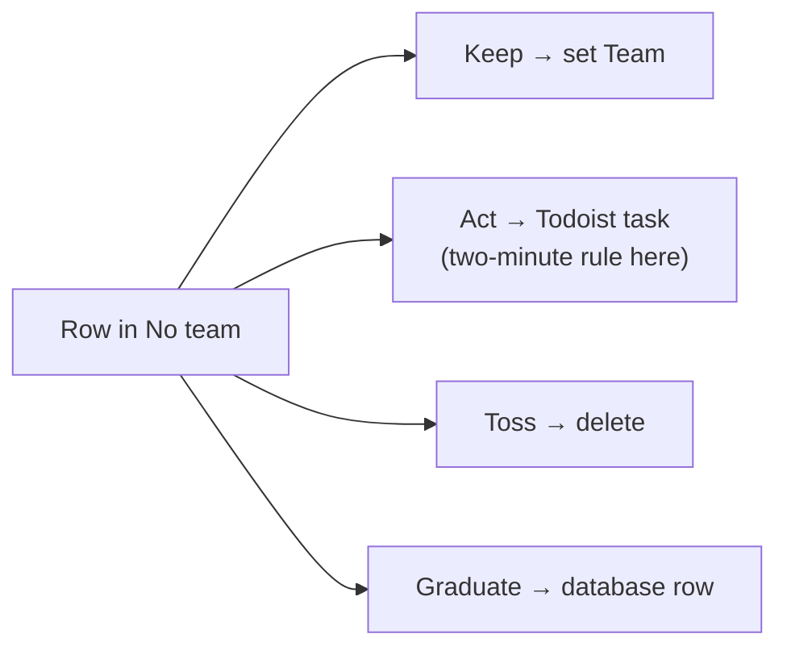
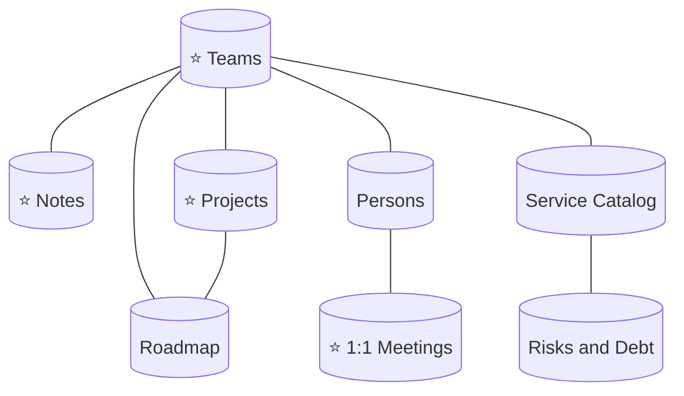
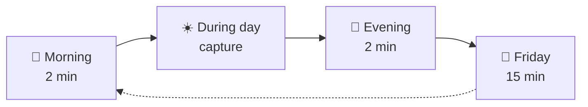

# Cheatsheet — Quick Reference

A condensed companion to `personal-productivity-system.md`. Use this when you already know the system; go back to the full document for the reasoning and to `example-workspace.md` to see everything filled with data.

---

## Where does this go?



| If it's… | It goes to |
|---|---|
| An action | Todoist |
| Today's top 3 | Notebook (shortlisted from Todoist) |
| Anything you heard, saw or thought — even half-formed | **Notes** (one line, nothing filed) |
| An idea | Notes, tag `idea` |
| A vague worry or a rough decision | Notes, tag `risk` / `decision`; graduates on Friday if it recurs |
| A project plan | The project's Notion page, as plain text |
| Didn't happen today | Notebook `→`, stays in Todoist |
| No longer needed | Notebook `✕`, delete in Todoist |

---

## Todoist

| Element | Value |
|---|---|
| Containers | `#Personal` · `#Work-General` · `#Work-Projects` |
| Routing rule | **Does the title end with a slug?** Yes → `#Work-Projects`. No → `#Work-General` |
| Naming | Start with a verb |
| Follow-ups | Start with **Chase** and give a date |
| Priority | `p1`–`p3` only when true |
| Labels | None |

| Container | For | Example |
|---|---|---|
| `#Work-Projects` | Commitments and checks that need attention | `Verify rollback test passed in staging (db-migration)` |
| `#Work-General` | Light reminders | `Email Ana about the offsite agenda` |
| `#Personal` | Outside work | `Renew gym membership` |

**Slug:** one short lowercase hyphenated name per project (`db-migration`). It goes in the Notion project name, at the end of Todoist titles and in Notes titles. Search the slug and everything about the project appears.

**Three saved filters**

| Name | Query |
|---|---|
| Today | `overdue \| today` |
| Due in 7 days | `due before: in 7 days` |
| Follow-ups | `search: Chase` |

**Subtasks** decompose one concrete task (a document with three steps). They never mirror the project plan.

```
☐ Prepare cutover runbook (db-migration)        Fri
    ☐ Collect failover steps from Ana
    ☐ Draft the runbook
    ☐ Review with the Atlas on-call
```

**Quick-add:** `Chase Ana for replication lag numbers (db-migration) #Work-Projects tue`

> **Verify in-app:** free-plan subtask due dates; hyphenated slug search. See "Things to verify" in the full document.

---

## Notebook

| Symbol | Meaning | Evening action |
|---|---|---|
| `□` | Picked this morning | — |
| `✓` | Done | Already checked in Todoist |
| `→` | Still open | Nothing, stays in Todoist |
| `✕` | No longer needed | Delete in Todoist |

Big 3 = a shortlist from Todoist, not a second task system. The page dies at midnight.

---

## Notes (Notion)

**Properties:** Title · Team · Tags · Created. Nothing else.

| Rule | Detail |
|---|---|
| One line per row | Don't file at capture |
| Title | `Team: the thing (slug)` — team prefix and slug are optional |
| Capture paths | Android: Notion Page widget on the Notes DB → New (iPhone: same widget, or Shortcuts); desktop pinned; keep it to two taps |
| Searching | Notion search is whole-word only ("tes" doesn't find "test"): type full words, and write titles with full words, not abbreviations |
| Don't put here | Actions (→ Todoist), meetings (→ the meeting page), 1:1 content (→ 1:1 page) |

| View | Filter | Use |
|---|---|---|
| Recent | none, newest first | Daily scan |
| **No team** | Team is empty | Friday triage queue |
| By team | grouped by Team | Everything about one team |
| Ideas | Tags contains `idea` | Quarterly review |
| All | none | Search |

**Friday triage: four fates**



Hesitating more than five seconds? **Keep** and set the team. The **Org-wide** team row exists so every note can leave the queue.

---

## Graduation ladder (rule of three)

| Stage | Trigger |
|---|---|
| 1. A note | The first time |
| 2. A tag + a filtered view | Three similar notes |
| 3. A database | Three real rows, same shape, and you filter them |

Two databases with the same shape are one database. If the real data lives elsewhere, link, don't copy.

---

## PARA (Notion)

| Category | Rule of thumb |
|---|---|
| **Projects** | Has an end, several sessions of work |
| **Areas** | Ongoing, never ends |
| **Resources** | Reference, no responsibility |
| **Archive** | Inactive, never deleted |

Never create an empty folder, tag or database before real content exists.

---

## Database or page?

| Question | Page | Database |
|---|---|---|
| How many items? | Few, stable | Many or growing |
| Same fields? | No | Yes |
| Filter / sort / compare? | No | Yes |
| Repeats? | No | Yes |

Two or more on one side decides. Tie → keep what you have.

| Property | Use when |
|---|---|
| Select | One value from a fixed list |
| Multi-select | Loose labels |
| Relation | A real two-way link, or a value duplicated in 3+ places |
| Date | A real date |
| Created / Last edited (built-in) | Free and automatic: prefer to a manual date |

---

## The Notion structure

```
⭐ Favorites (max 6)   Notes · Projects · Teams · Meetings · 1:1 Meetings
────────────────────────
🗂️ Projects          ← the Projects database itself
🟩 Areas             Notes · Teams · Meetings · People Management
                       (Persons, 1:1) · Technology (when 3+ tech DBs)
🟨 Resources         Pages: runbooks, "Metrics I watch", house rules
📦 Archive           Retired pages
```



---

## All databases at a glance

**Core (eight)**

| Database | Key fields | One-liner |
|---|---|---|
| **Notes** | Team, Tags, Created | The information inbox |
| **Projects** | Status, Priority, Risk, Team, Target, Tracker | Anything with an end; default page template |
| **Teams** | Name, Full name | The hub; includes **Org-wide** |
| **Persons** | Team, Role, Last 1:1 | Who you work with |
| **1:1 Meetings** | Person | One page per person, grows forever |
| **Meetings** | Type, Project, Team | One row per series |
| **Service Catalog** | Team, Category, Criticality, Status, SLO | Systems you own; SLO section in the page |
| **Roadmap** | Horizon, Year, Status, Theme, Team, Related Project | One DB for every year |

**Optional — only when the rule of three is met**

| Database | Verdict | Key fields |
|---|---|---|
| **Decisions** | Yes | Status, Team, Confidence, Superseded by, Date |
| **Risks and Debt** | Yes (one DB, Type = Risk / Issue / Debt) | Type, Impact, Likelihood, Effort, Status, System |
| **Technology Radar** | Conditional | Quadrant, Ring (Adopt / Trial / Assess / Hold), Team |
| SLOs & Reliability | **No** | Property + section on the Service page |
| KPIs & Metrics | **No** | One page: *Metrics I watch* |
| Technical initiatives | **No** | Roadmap → Projects |
| Incidents / postmortems | **No** | Link to the official one |
| Runbooks | **No** | Pages |
| Hiring / OKRs | Out of scope | — |
| Dependencies / assumptions | **No** | Project page + `Chase` task |

Test for an optional DB: **three or more records of the same shape that I want to filter.**

---

## Closing things out

| Thing | How |
|---|---|
| A **Project** | `Status → Done`, stays in the DB |
| A **Service** | `Status → Deprecated` (`Legacy` stays visible) |
| A **Decision** | `Superseded` + link to the newer one |
| A **Risk / Debt** | `Closed` or `Accepted` |
| A **Radar** item | Move the Ring, don't delete |
| An **idea** (note) | Drop it, or it becomes a Project |
| A plain **page** | Move to Archive |

Rows with a Status: change the status. Don't move the row.

---

## Rituals



| When | Do |
|---|---|
| Morning | *Due in 7 days* → pick the Big 3 |
| During the day | Capture to Notes or Todoist, nothing else |
| Evening | `✓` `→` `✕`; delete `✕` in Todoist |
| **Friday (15 min)** | 1. *Due in 7 days* (3) · 2. *Follow-ups* (2) · 3. Projects: search each `Now` slug (3) · 4. Notes: triage *No team* (4) |
| Monthly | Risks and Debt (Open · High) · Metrics page · Service Catalog by oldest edit |
| Every 3 months | Decisions and Radar · Roadmap and Ideas |

All periodic reviews are **recurring Todoist tasks**, not memory.

---

## Designing any new database

1. Few properties: only what you'll filter or sort by.
2. Right type per field.
3. Title identifies the row alone.
4. Rich content → page body.
5. Two or three views: daily filtered, grouped overview, unfiltered audit.
6. Built-in dates before manual ones.
7. Name the concrete question it answers *today*. No answer, no database.
8. Rows needing very different fields → split, or it isn't a database.
9. Same shape as an existing database → merge.
10. When it fails twice, remove something before adding something.

---

## A one-screen example (full version in `example-workspace.md`)

| Where | What |
|---|---|
| Notes (Tue) | `Decision: all new services publish to the Event Bus (bus-upgrade)` |
| Friday triage | Graduate → Decisions row `Accepted` |
| Projects | `bus-upgrade` moves `Next` → `Now` |
| Todoist | `Draft the event contract template (bus-upgrade)` in `#Work-Projects` |
| Todoist | `Chase Vendor X for the audit report (access-review)` in `#Work-Projects`, shown by the Follow-ups filter |
| Notebook | `→ Draft the event contract template (bus-upgrade)` |
