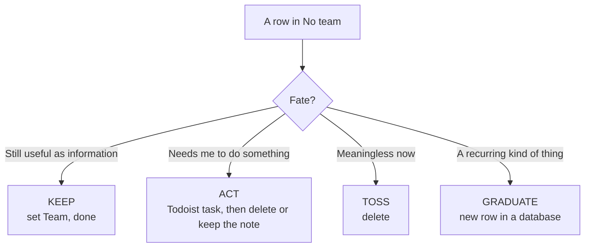
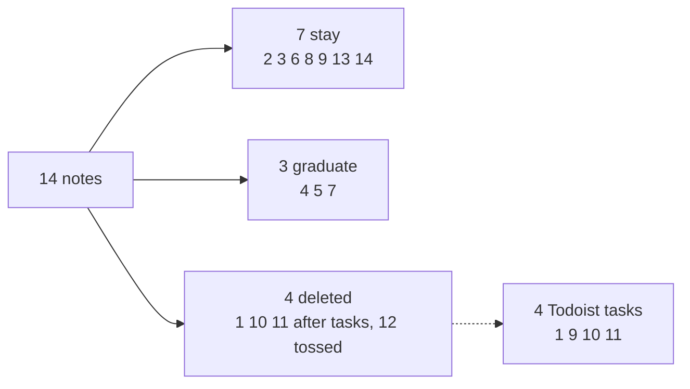
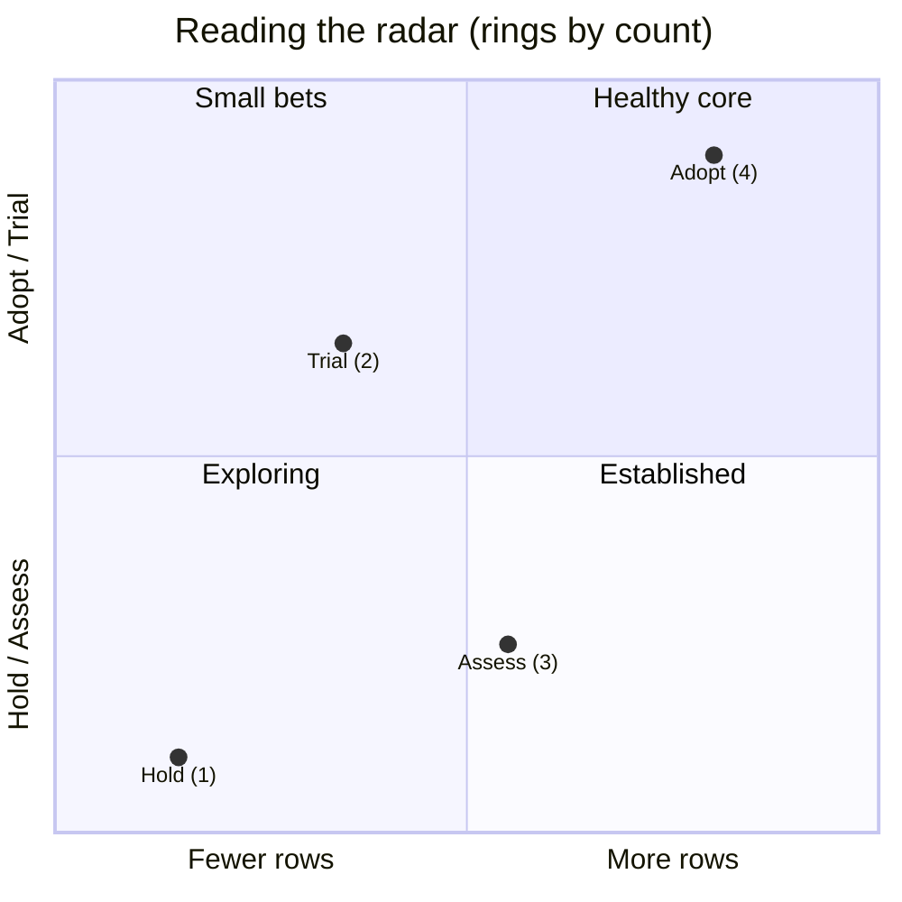
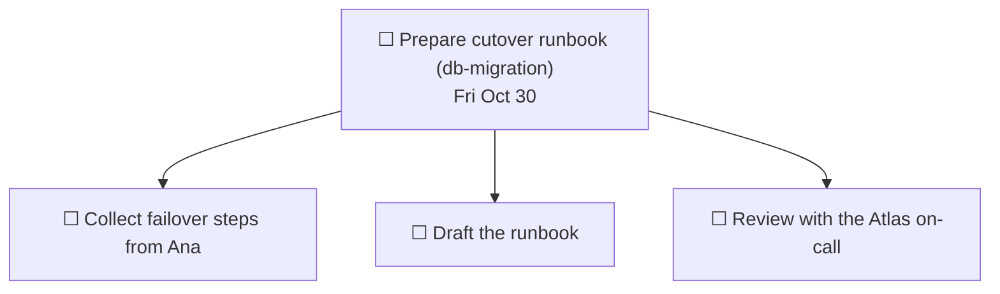

# Example Workspace — the whole system, filled with dummy data

A companion to `personal-productivity-system.md`. Read it like a folder of screenshots: every screen of the system, populated, for one fictional company (**Acme**, three platform teams, about twenty engineers). Nothing here is real. Names, numbers and dates are invented.

**"Today" is Monday, October 26, 2026.** Notes cover Oct 12–23; Todoist shows the state on Monday morning; the last section walks through the full week.

## Contents

1. [Cast and vocabulary](#1-cast-and-vocabulary)
2. [The sidebar](#2-the-sidebar)
3. [Notes database](#3-notes-database)
4. [Friday triage, step by step](#4-friday-triage-step-by-step)
5. [Teams, Persons, Meetings](#5-teams-persons-meetings)
6. [Projects and project pages](#6-projects-and-project-pages)
7. [Service Catalog](#7-service-catalog)
8. [Roadmap](#8-roadmap)
9. [Optional databases: Decisions, Risks and Debt, Technology Radar](#9-optional-databases)
10. [Resources: pages, not databases](#10-resources-pages-not-databases)
11. [Todoist](#11-todoist)
12. [Notebook](#12-notebook)
13. [A full week, day by day](#13-a-full-week-day-by-day)
14. [Where one fact lives](#14-where-one-fact-lives)
15. [Build it in 45 minutes](#15-build-it-in-45-minutes)
16. [Health checks](#16-health-checks)

---

## 1. Cast and vocabulary

| Team | Full name | Lead | Owns |
|---|---|---|---|
| **Atlas** | Platform Infrastructure | Ana Reyes | Databases, messaging, Kubernetes |
| **Beacon** | Data Platform | Chloe Martin | Warehouse, pipelines |
| **Cobalt** | Developer Experience | Elena Rossi | CI, build tooling |
| **Org-wide** | Cross-team | — | Notes that belong to nobody in particular |

| Slug | Project | Status |
|---|---|---|
| `db-migration` | Core DB migration | Now |
| `ci-revamp` | CI pipeline revamp | Now |
| `bus-upgrade` | Event Bus upgrade | Next |
| `slo-rollout` | SLO rollout | Next |
| `cost-review` | Cloud cost review | Later |
| `access-review` | Access review | On Hold |
| `dr-test` | DR failover test | Done |

**Three words used everywhere**

| Word | Meaning | Example |
|---|---|---|
| **Slug** | Short lowercase name ending a title | `(db-migration)` |
| **Chase** | Verb for "I'm waiting on someone" | `Chase Ana for replication lag numbers (db-migration)` |
| **Graduate** | Move a note into its own database row | Note → Decisions |

---

## 2. The sidebar

```
⭐ Favorites (5)
   📝 Notes
   🗂️ Projects
   👥 Teams
   📅 Meetings
   🤝 1:1 Meetings
────────────────────────
🗂️ Projects                  ← the Projects database itself
🟩 Areas
   📝 Notes
   👥 Teams
   📅 Meetings
   🧑‍🤝‍🧑 People Management
        Persons
        1:1 Meetings
   🛠️ Technology
        Service Catalog
        Roadmap
        Decisions
        Risks and Debt
        Technology Radar
🟨 Resources
   Failover runbook
   Metrics I watch
   House rules for deploy freezes
📦 Archive
   2025
```

Five favorites (limit: six). Everything else is one click from Teams, or one search away.

---

## 3. Notes database

**Properties:** Title · Team (relation) · Tags (multi-select) · Created (built-in). Nothing else.

### View: Recent (sorted by Created, newest first)

| Created | Title | Team | Tags |
|---|---|---|---|
| Fri Oct 23 | Quarterly planning: Cobalt wants CI templates in H1 (ci-revamp) | — | `planning` |
| Fri Oct 23 | Atlas: Core DB error budget 60% burned this month (db-migration) | — | `metric` |
| Thu Oct 22 | Maybe move the Thursday sync to 9:45? | — | |
| Thu Oct 22 | Beacon: Dev asked to pair with Atlas on warehouse snapshots | — | |
| Thu Oct 22 | Atlas: on-call handoff doc is outdated, missing DB failover steps | — | `process` |
| Wed Oct 21 | Vendor X renewal due Jan 15, pricing +20% (access-review) | — | `vendor` |
| Wed Oct 21 | Cobalt: build cache hit rate dropped to 55% (ci-revamp) | — | `metric` |
| Wed Oct 21 | Risk: only one person knows the legacy scheduler setup | — | `risk` |
| Tue Oct 20 | Idea: weekly 15-min "ask the platform" office hours | — | `idea` |
| Tue Oct 20 | Atlas: Kubernetes is two minor versions behind | — | `debt` |
| Tue Oct 20 | Decision: all new services publish to the Event Bus (bus-upgrade) | — | `decision` |
| Mon Oct 19 | Cobalt: new runner images land Nov 3, expect a flaky week (ci-revamp) | — | `process` |
| Mon Oct 19 | Beacon: warehouse nightly load now takes 3h, was 1h (data-warehouse) | — | `system` |
| Mon Oct 19 | Atlas: cutover rehearsal needs a 4h freeze window — ask Cobalt (db-migration) | — | |

Team is empty on every row: nothing was filed at capture. That is the point.

### View: No team (filter: Team is empty) — the Friday queue

Same rows as above on Friday morning. After triage, this view is empty.

### View: By team (grouped by Team) — after triage, with older notes

| Team | Title | Tags | Created |
|---|---|---|---|
| **Atlas** | Core DB error budget 60% burned this month (db-migration) | `metric` | Oct 23 |
| **Atlas** | Vendor X renewal due Jan 15, pricing +20% (access-review) | `vendor` | Oct 21 |
| **Atlas** | Core DB failover takes 3–5 min, not the 90 s quoted in the old doc | `system` | Oct 13 |
| **Atlas** | Pager rotation: swap rule — trade by Wednesday noon | `process` | Oct 12 |
| **Beacon** | Warehouse nightly load now takes 3h, was 1h (data-warehouse) | `system` | Oct 19 |
| **Beacon** | Analytics wants a read replica with 5-minute lag, not 1 hour | `system` | Oct 14 |
| **Beacon** | Dev's contract with the BI vendor ends in March | `vendor` | Oct 13 |
| **Cobalt** | Runner images land Nov 3, expect a flaky week (ci-revamp) | `process` | Oct 19 |
| **Cobalt** | Build cache hit rate dropped to 55% (ci-revamp) | `metric` | Oct 21 |
| **Cobalt** | Wants CI templates in H1 (ci-revamp) | `planning` | Oct 23 |
| **Cobalt** | Flaky test list: 14 quarantined, oldest from March | `debt` | Oct 15 |
| **Org-wide** | Weekly 15-min "ask the platform" office hours | `idea` | Oct 20 |
| **Org-wide** | Offsite: facilities needs headcount by Oct 23 | `planning` | Oct 12 |
| **Org-wide** | Finance closes budget requests on Nov 20 | `planning` | Oct 14 |

### View: Ideas (filter: Tags contains `idea`)

| Created | Idea | Team |
|---|---|---|
| Oct 20 | Weekly 15-min "ask the platform" office hours | Org-wide |
| Sep 28 | A "paved road" template repo for new services | Cobalt |
| Sep 11 | Chaos day once a quarter | Atlas |
| Aug 30 | Publish a monthly "state of the platform" one-pager | Org-wide |

Reviewed quarterly. Each idea ends in one of two ways: dropped, or it becomes a Project row.

### Finding things later

| You remember… | Search for… | Finds |
|---|---|---|
| "Something about failover time" | `failover` | The Oct 13 note, the Failover runbook, Core DB service page |
| "What did Cobalt say about templates?" | `Cobalt templates` | The Oct 23 note |
| "Everything on that project" | `db-migration` | Notes, project page, Todoist tasks (Todoist search separately) |
| "Which vendor renews in January?" | `renewal` | The Oct 21 note |

---

## 4. Friday triage, step by step

Friday Oct 23, view **No team**, 14 rows, five minutes. One of four fates for each row.



| # | Note | Fate | Action taken |
|---|---|---|---|
| 1 | Cutover rehearsal needs a 4h freeze | **Act** | Todoist: `Ask Cobalt for a 4h deploy freeze before rehearsal (db-migration)`; note deleted |
| 2 | Warehouse load 3h | **Keep** | Team → Beacon |
| 3 | Runner images Nov 3 | **Keep** | Team → Cobalt |
| 4 | Event Bus decision | **Graduate** | Decisions row, `Accepted` |
| 5 | Kubernetes behind | **Graduate** | Risks and Debt row, `Debt`, impact Medium, effort M |
| 6 | Office hours idea | **Keep** | Team → Org-wide, tag `idea` stays |
| 7 | Single point of knowledge | **Graduate** | Risks and Debt row, `Risk`, impact High |
| 8 | Cache hit rate 55% | **Keep** | Team → Cobalt |
| 9 | Vendor X renewal | **Act** | Todoist: `Chase procurement for the Vendor X renewal terms (access-review)`; note kept (holds the date), Team → Atlas |
| 10 | On-call doc outdated | **Act** | Todoist: `Update the on-call handoff doc with DB failover steps` |
| 11 | Dev wants to pair | **Act** | Todoist: `Ask Ana about pairing on warehouse snapshots` |
| 12 | Move sync to 9:45? | **Toss** | Deleted |
| 13 | Error budget 60% burned | **Keep** | Team → Atlas |
| 14 | Cobalt wants CI templates | **Keep** | Team → Cobalt |



Result: queue empty; 7 notes, 3 records, 4 tasks. Rule of thumb: if you hesitate for more than five seconds on a row, **Keep** it and set the team.

---

## 5. Teams, Persons, Meetings

### Teams

| Name | Full name | Persons | Projects (rollup) | Notes (rollup) |
|---|---|---|---|---|
| Atlas | Platform Infrastructure | 2 | db-migration, bus-upgrade, access-review, dr-test | 6 |
| Beacon | Data Platform | 2 | bus-upgrade | 3 |
| Cobalt | Developer Experience | 2 | ci-revamp, slo-rollout | 4 |
| Org-wide | Cross-team | 0 | — | 3 |

Opening a Team page shows its people, projects, services, risks and notes — the hub everything relates to.

### Persons

| Name | Team | Role | Last 1:1 | Next 1:1 |
|---|---|---|---|---|
| Ana Reyes | Atlas | Tech Lead | Oct 21 | Nov 4 |
| Ben Okafor | Atlas | SRE | Oct 14 | Oct 28 |
| Chloe Martin | Beacon | Engineering Manager | Oct 20 | Nov 3 |
| Dev Patel | Beacon | Data Engineer | Oct 9 | **Oct 26 (overdue)** |
| Elena Rossi | Cobalt | Tech Lead | Oct 22 | Nov 5 |
| Farid Haddad | Cobalt | Developer | Oct 16 | Oct 30 |

### A 1:1 page (one per person, never recreated)

```
DEV PATEL — Beacon · Data Engineer

NEXT
  · Ask about the pairing on warehouse snapshots
  · His interest in the streaming work
  · Career: wants a mentor outside the team

LOG
Oct 9
  · Warehouse nightly load slowing; he has a theory (partition skew)
  · Agreed: he writes up findings by Oct 16  → chased, delivered Oct 15
  · Mentioned wanting more design review exposure
Sep 25
  · Onboarding to the pipeline on-call; shadowing Chloe
```

Items under NEXT are written whenever they occur to you. At the 1:1, read from the top; afterwards, move them down into the LOG with what was decided.

### Meetings (one row per series, the page grows)

| Name | Type | Project | Team |
|---|---|---|---|
| Platform weekly sync | Recurring | — | — |
| Architecture review | Recurring | — | Atlas |
| Monthly reliability review | Recurring | — | Atlas |
| Quarterly planning | Recurring | — | — |
| Vendor X check-in | On Demand | access-review | Atlas |

**One meeting page — Monthly reliability review**

```
MONTHLY RELIABILITY REVIEW — Atlas · Recurring, first Thursday

Standing agenda
  1. Error budgets  2. Open high-impact risks  3. Incidents  4. SLO gaps

Oct 1
  Attendees: Ana, Ben, Chloe
  · Core DB at 82% budget left; Event Bus at 91%
  · SLO for Container Platform still missing → Ana owns the draft
  · Decision: tighten the deploy freeze policy (see Decisions)
  Actions
    → Todoist: Chase Ana for the Container Platform SLO draft (slo-rollout)

Sep 3
  · No incidents; flaky failover test noted
```

---

## 6. Projects and project pages

### Projects database

| Name | Status | Priority | Target | Risk | Team | Tracker |
|---|---|---|---|---|---|---|
| Core DB migration (db-migration) | **Now** | P1 | Q1 2027 | 🟠 | Atlas | PLAT-120 |
| CI pipeline revamp (ci-revamp) | **Now** | — | Dec 2026 | 🟢 | Cobalt | PLAT-98 |
| Event Bus upgrade (bus-upgrade) | Next | — | Q1 2027 | 🟢 | Atlas, Beacon | PLAT-131 |
| SLO rollout (slo-rollout) | Next | — | Q2 2027 | 🟢 | Atlas, Cobalt | PLAT-140 |
| Cloud cost review (cost-review) | Later | — | — | 🟢 | — | — |
| Access review (access-review) | On Hold | — | Nov 2026 | 🟠 | Atlas | PLAT-105 |
| DR failover test (dr-test) | Done | — | Sep 2026 | 🟢 | Atlas | PLAT-77 |

Views: **Active** (`Status is not Done`, grouped by Status) · **Done** (a running record) · **By team**.

### Project page: Core DB migration (Now · P1)

```
CORE DB MIGRATION (db-migration)      Now · P1 · Atlas · Risk 🟠 · PLAT-120

Objective     Core DB on managed PostgreSQL 16, ≤ 10 min downtime at cutover.
Context       Self-hosted cluster goes out of support Q2 2027. Beacon reads
              from a replica, so their jobs pause during cutover.
Assumptions   Replication lag stays under 5 s under load.
              → check: "Chase Ana for replication lag numbers" (Todoist)
Plan          1. Assess — sizing and extensions               (done)
              2. Rehearse — two full rehearsals                (Nov)
              3. Cutover — a Saturday in January
              4. Clean up — decommission the old cluster
Decisions     Oct 12 — managed service over self-hosted
              Oct 26 — 4h deploy freeze around each rehearsal
Links         PLAT-120 · Rehearsal checklist · Capacity dashboard
Document      → Cutover runbook (sub-page)
```

### Project page: CI pipeline revamp (Now)

```
CI PIPELINE REVAMP (ci-revamp)        Now · Cobalt · Risk 🟢 · PLAT-98

Objective     Median pipeline time under 10 min; cache hit rate above 80%.
Context       Runner images are two years old; flaky tests erode trust.
Assumptions   New runner images (v3) don't break any build.
              → check: "Verify new runner images pass smoke tests" (Todoist)
Plan          1. Pilot v3 images on two repos          (Nov 3)
              2. Cache redesign
              3. Self-service templates                (H1 2027 on the roadmap)
Decisions     Oct 22 — adopt v3 org-wide after the pilot (Proposed)
Links         PLAT-98 · CI dashboard
```

### Project page: Access review (On Hold)

```
ACCESS REVIEW (access-review)         On Hold · Atlas · Risk 🟠 · PLAT-105

Objective     Quarterly review of who has access to what, evidence for audit.
Why on hold   Waiting for Vendor X's audit report and renewal terms.
Waiting on    Vendor X (audit report) · Procurement (renewal terms)
              → both are `Chase` tasks in Todoist; nothing else open
Resume when   Audit report received
```

Note how an `On Hold` project has **only** `Chase` tasks in Todoist, and nothing that implies work is happening.

### Project page: Event Bus upgrade (Next)

```
EVENT BUS UPGRADE (bus-upgrade)       Next · Atlas, Beacon · PLAT-131

Objective     Upgrade the Event Bus two minor versions; adopt event contracts.
Context       Decision of Oct 20: new services publish through the bus only.
Plan          1. Event contract template
              2. Compatibility test in staging
              3. Rolling upgrade, one broker at a time
Starts        When db-migration cutover rehearsal #1 is done
```

---

## 7. Service Catalog

| Name | Team | Category | Criticality | Status | SLO | Last edited |
|---|---|---|---|---|---|---|
| Core DB (PostgreSQL) | Atlas | Database | 🔴 Critical | Active | Defined | Oct 23 |
| Event Bus (Kafka) | Atlas | Messaging | 🔴 Critical | Active | Defined | Oct 20 |
| Container Platform (Kubernetes) | Atlas | Infra/Platform | 🔴 Critical | Active | **Missing** | Sep 2 |
| CI Pipeline (GitLab CI) | Cobalt | CI/CD | 🟠 Important | Active | Missing | Oct 21 |
| Data Warehouse | Beacon | Database | 🟠 Important | Active | Missing | Oct 22 |
| Legacy Job Scheduler | Atlas | Infra/Platform | 🟠 Important | Legacy | n/a | Aug 14 |
| Old Mail Relay | Atlas | Infra/Platform | 🟢 Low | Deprecated | n/a | Jun 3 |

Useful view: **Critical and SLO = Missing** → exactly one row (Container Platform). That is the to-do.
Audit view: sorted by `Last edited time` ascending → oldest first (Old Mail Relay, Legacy Scheduler, Container Platform).

### Service page: Core DB

```
CORE DB (PostgreSQL)     Atlas · Database · 🔴 Critical · Active · SLO Defined

Known limitations
  · Single writer; failover takes 3–5 min
  · Extensions pinned to v14 until the migration

Common issues and fixes
  · Replication lag spikes at month-end → pause batch exports on Beacon's replica
  · Connection storms after deploys → restart the pooler, not the database

Improvement ideas
  · Automated failover test every quarter

Links    Failover runbook · Capacity dashboard

SLO
  SLI      Share of connection attempts that succeed
  SLO      99.95% over 28 days
  Budget   0.05% ≈ 20 min full downtime per 28 days
  Owner    Ana
  Policy   Budget spent → no risky changes until it recovers
```

### Service page: Container Platform (SLO missing)

```
CONTAINER PLATFORM (Kubernetes)     Atlas · Infra · 🔴 Critical · SLO Missing

Known limitations
  · Two minor versions behind (see Risks and Debt)
  · Node pool upgrades need a 30-min drain window

Common issues and fixes
  · Pods Pending after node upgrade → check PodDisruptionBudgets first

SLO
  (to be drafted — owner Ana, tracked in slo-rollout)
```

---

## 8. Roadmap

| Name | Horizon | Year | Status | Theme | Team | Related Project |
|---|---|---|---|---|---|---|
| Core DB migration | This year | 2026 | In Progress | Reliability | Atlas | db-migration |
| CI pipeline revamp | This year | 2026 | In Progress | Developer Experience | Cobalt | ci-revamp |
| Self-service CI templates | Next year | 2027 | Planned | Developer Experience | Cobalt | — |
| SLOs for critical services | Next year | 2027 | Planned | Reliability | — | slo-rollout |
| Cost visibility per team | Next year | — | Planned | Cost | — | cost-review |
| Multi-region data layer | Someday | — | Planned | Reliability | — | — |
| Retire the legacy job scheduler | This year | 2026 | Cut | Cost | Atlas | — |

The roadmap is never recreated per year; `Year` is filled only when it is honest. A row with a `Related Project` is what turns a plan into work; a row without one is still an intention.

---

## 9. Optional databases

Each of these earned its place by passing one test: **three or more records of the same shape that I want to filter.**

### Decisions

| Decision | Status | Team | Confidence | Superseded by | Date |
|---|---|---|---|---|---|
| All new services publish to the Event Bus; no shared DB access | Accepted | Atlas, Beacon | High | — | Oct 20 |
| Freeze deploys for 4h around each cutover rehearsal | Accepted | Atlas, Cobalt | High | — | Oct 26 |
| Adopt runner images v3 org-wide after the pilot | Proposed | Cobalt | Medium | — | Oct 22 |
| Keep the legacy job scheduler until the DB migration is done | Accepted | Atlas | Medium | — | Oct 12 |
| Retire the legacy job scheduler in 2026 | Superseded | Atlas | Low | *Keep the scheduler…* | Aug 3 |

```
ALL NEW SERVICES PUBLISH TO THE EVENT BUS
Accepted · Atlas, Beacon · Confidence: High · Oct 20, 2026

Context        Three services read each other's tables directly. A schema change
               in one broke another twice this quarter.
Decision       New services publish and consume events through the Event Bus.
               Direct access to another service's database is not allowed.
Consequences   + Schemas change without coordinating releases
               − Every consumer needs an event contract; some added latency
Revisit when   The Event Bus misses its SLO two months running
```

### Risks and Debt (one database, Type = Risk / Issue / Debt)

| Name | Type | Impact | Likelihood | Effort | Status | Team | System |
|---|---|---|---|---|---|---|---|
| Single point of knowledge on the legacy scheduler | Risk | High | Medium | — | Open | Atlas | Legacy Job Scheduler |
| Kubernetes is two minor versions behind | Debt | Medium | — | M | Open | Atlas | Container Platform |
| Nightly warehouse load takes 3h and rising | Issue | High | — | — | Mitigating | Beacon | Data Warehouse |
| Flaky integration tests quarantined, never fixed | Debt | Low | — | S | Open | Cobalt | CI Pipeline |
| Deprecated mail relay still referenced by two scripts | Risk | Medium | Low | — | Accepted | Atlas | Old Mail Relay |
| No automated failover tests for the core database | Debt | High | — | L | Open | Atlas | Core DB |

**Monthly review view: Open and High impact** → 3 rows. Each must end in one of three states: has a next action in Todoist, `Accepted`, or `Closed`.

| Row in view | Next action (in Todoist) |
|---|---|
| Single point of knowledge | `Schedule a knowledge-transfer session on the legacy scheduler` |
| Warehouse load 3h | `Ask Ana about pairing on warehouse snapshots` |
| No failover tests | `Draft the failover test plan (dr-test follow-up)` — or Accept it |

### Technology Radar

| Name | Quadrant | Ring | Team |
|---|---|---|---|
| Kubernetes | Platforms | **Adopt** | Atlas |
| Terraform | Tools | **Adopt** | Atlas |
| Kafka | Platforms | **Adopt** | Atlas |
| Trunk-based development | Techniques | **Adopt** | Cobalt |
| GitLab CI runners v3 | Tools | **Trial** | Cobalt |
| OpenTelemetry | Tools | **Trial** | Atlas |
| Service mesh | Platforms | **Assess** | Atlas |
| Feature-flag platform | Tools | **Assess** | Cobalt |
| Rust for internal tooling | Languages and Frameworks | **Assess** | Cobalt |
| Self-managed message queue (old) | Platforms | **Hold** | Atlas |



The point of the radar is the last row: `Hold` means "don't start new uses", even though the Service Catalog may still say `Active`.

### Considered and rejected (no database)

| Candidate | Why not | Where it lives instead |
|---|---|---|
| SLOs & Reliability | Fewer than ~5 rows; belongs to a service | `SLO` property + SLO section on the Service page |
| KPIs & Metrics | Numbers live in the tools that produce them | One page: *Metrics I watch* |
| Technical initiatives | Same shape as Roadmap → Projects | Roadmap rows linked to Projects |
| Incidents / postmortems | The official postmortem already exists elsewhere | Link from the Service page |
| Runbooks | Long, unique documents | Pages under Resources |
| Dependencies / assumptions | Per-project | Project page + a `Chase` task |

---

## 10. Resources: pages, not databases

**Metrics I watch** (one page, a table; one manual column)

| Metric | Why | Source | Owner | Cadence | Last reading |
|---|---|---|---|---|---|
| Deployment frequency | Delivery speed | CI dashboard | Elena | Weekly | 14/day (Oct 23) |
| Lead time for changes | Delivery speed | CI dashboard | Elena | Weekly | 2.1 days (Oct 23) |
| Change failure rate | Stability | Incident tool | Ana | Monthly | 12% (Sep) |
| Time to restore service | Stability | Incident tool | Ana | Monthly | 38 min (Sep) |
| Core DB error budget left | Reliability | Observability → Core DB SLO | Ana | Monthly | 40% (Oct 23) |
| Pages per on-call week | Toil | On-call tool | Ben | Monthly | 11 (Sep) |

**House rules for deploy freezes** (one short page)

```
· A freeze is declared in #platform at least 48h ahead
· Freeze windows: rehearsals (4h), cutover (full day), quarter-end (last 3 days)
· Emergencies bypass the freeze with Ana's or Chloe's approval
· After any bypass: write one line in the Decisions DB
```

**Failover runbook** (long page, not shown): numbered steps, who to page, rollback, verification queries.

---

## 11. Todoist

### Monday morning, Oct 26

```
#Work-Projects
☐ Ask Cobalt for a 4h deploy freeze before rehearsal (db-migration)        Tue Oct 27
☐ Chase Ana for replication lag numbers (db-migration)                     Tue Oct 27
☐ Verify rollback test passed in staging (db-migration)                    Wed Oct 28   p1
☐ Prepare cutover runbook (db-migration)                                   Fri Oct 30
    ☐ Collect failover steps from Ana
    ☐ Draft the runbook
    ☐ Review with the Atlas on-call
☐ Chase Elena for the template spec draft (ci-revamp)                      Fri Oct 30
☐ Verify new runner images pass smoke tests (ci-revamp)                    Tue Nov 3
☐ Chase Vendor X for the audit report (access-review)                      Mon Nov 2
☐ Chase procurement for the Vendor X renewal terms (access-review)         Tue Nov 3

#Work-General
☐ Send the offsite headcount to facilities                                 Fri Oct 23   ⚠ overdue
☐ Email Ana about the offsite agenda                                       Mon Oct 26
☐ Ask Ana about pairing on warehouse snapshots                             Tue Oct 27
☐ Book a room for quarterly planning                                       Wed Oct 28
☐ Mention the freeze window to Team Beacon at the Thursday sync            Thu Oct 29
☐ Update the on-call handoff doc with DB failover steps                    Fri Oct 30
☐ Review risks and debt                                  ↻ every month     Fri Oct 30
☐ Review radar and decisions                             ↻ every 3 months  Mon Nov 2
☐ Review roadmap and ideas                               ↻ every 3 months  Mon Nov 16

#Personal
☐ Book car service appointment                                             Sat Oct 31
☐ Renew gym membership                                                     Fri Nov 6
```

Rule that decides the container: **does the title end with a slug?** Yes → `#Work-Projects`. No → `#Work-General`.

### The three saved filters

| Filter | Query | Result on Monday |
|---|---|---|
| **Today** | `overdue \| today` | Send the offsite headcount (⚠) · Email Ana about the offsite agenda — **2 tasks** |
| **Due in 7 days** | `due before: in 7 days` | The overdue task plus everything through Sat Oct 31 — **13 tasks**, `p1` first |
| **Follow-ups** | `search: Chase` | Ana (Tue 27) · Elena (Fri 30) · Vendor X (Mon Nov 2) · Procurement (Tue Nov 3) — **4 tasks** |

**Search for a slug**, typing `db-migration` in the search bar, returns the four open tasks for that project across both containers.

### Quick-add lines (what you type → what you get)

| You type | Result |
|---|---|
| `Chase Ana for replication lag numbers (db-migration) #Work-Projects tue` | Follow-up in Projects, due Tuesday |
| `Email Ana about the offsite agenda #Work-General today` | Light reminder, due today |
| `Verify rollback test passed in staging (db-migration) #Work-Projects wed p1` | Commitment with priority |
| `Renew gym membership #Personal fri` | Personal, due Friday |
| `Review risks and debt #Work-General every month` | Recurring review |

### When a task gets subtasks



Subtasks decompose **one concrete task** with distinct steps. They are not a mirror of the project plan (that lives in the Notion page).

### The most common mistake, and the fix

| Wrong | Right | Why |
|---|---|---|
| `☐ Core DB migration` (parent) with 20 subtasks | Plan in Notion; only the *next* steps in Todoist | The plan changes weekly; a mirrored copy goes stale |
| `Waiting for Ana` in a label | `Chase Ana for X (slug)` with a due date | A follow-up needs a date or it never happens |
| `Check the thing` | `Verify rollback test passed in staging (db-migration)` | Verb-first and a slug make it self-explanatory in a filter |

---

## 12. Notebook

**Tuesday, October 27**, the Big 3 picked from *Due in 7 days*.

```
Tuesday, October 27
─────────────────────────────────────
BIG 3
✓  Ask Cobalt for a 4h deploy freeze before rehearsal (db-migration)
✓  Chase Ana for replication lag numbers (db-migration)
→  Prepare cutover runbook (db-migration)  — outline started, stays in Todoist
- - - - - - - - - - - - - - - - - - -
Tomorrow, maybe: verify the rollback test
```

| Symbol | Meaning | Todoist action at the end of the day |
|---|---|---|
| ✓ | Done | Already checked off |
| → | Still open | Nothing — it stays |
| ✕ | No longer needed | Delete in Todoist |

The page dies at midnight. Nothing is migrated.

---

## 13. A full week, day by day

### Monday, Oct 26

| Time | What happens | Where it goes |
|---|---|---|
| 08:45 | Morning, 2 min: *Due in 7 days* (13 tasks). Pick the Big 3 | Notebook |
| 10:30 | Corridor: Chloe says a new monthly batch job starts in March, doubles load | **Notes**: `Beacon: new monthly batch job starts in March, doubles warehouse load (data-warehouse)` |
| 11:00 | Platform weekly sync | The meeting's page, one dated entry |
| 14:15 | Asked to warn Beacon about the freeze | Todoist: `Mention the freeze window to Team Beacon at the Thursday sync #Work-General Thu` |
| 17:30 | Close the day: `✓` `→` `✕` | Notebook |

### Tuesday, Oct 27

| Time | What happens | Where it goes |
|---|---|---|
| 08:45 | Big 3 (see §12) | Notebook |
| 09:30 | Message Cobalt about the freeze → they agree to 4h | Todoist task checked; Project page: Decisions line added; Decisions DB gets a row (it's the third freeze-related decision → pattern) |
| 11:00 | Ana sends the replication lag numbers (Tue-morning chase) | Task checked; Assumption on project page updated |
| 15:00 | Stray thought: "should we sunset the mail relay?" | Notes: `Old Mail Relay: sunset by December?` (one line) |

### Wednesday, Oct 28

| Time | What happens | Where it goes |
|---|---|---|
| 08:45 | Big 3: verify rollback, book room, 1:1 with Ben | Notebook |
| 10:00 | 1:1 with Ben | His page: NEXT items read, LOG entry added |
| 10:45 | In the 1:1, Ben mentions pager fatigue | Notes: `Ben: pages per on-call week trending up, 11 in Sep` (tag `metric`) |
| 13:00 | Verify rollback test: it failed | Todoist: task checked; new `Fix rollback test in staging (db-migration)`; project Risk 🟠 stays |

### Thursday, Oct 29

| Time | What happens | Where it goes |
|---|---|---|
| 09:30 | Thursday sync: mention freeze to Beacon | Task checked |
| 09:45 | Beacon asks for the freeze dates in writing | Todoist: `Send Beacon the freeze dates in writing (db-migration)` |
| 14:00 | Monthly reliability review | Meeting page: new dated entry; actions → Todoist |

### Friday, Oct 30 — the 15-minute review

| Pass | What you find | What you do | Time |
|---|---|---|---|
| 1. **Due in 7 days** | Two tasks slipped | Moved to Monday | 3 min |
| 2. **Follow-ups** | Elena still hasn't sent the template spec | Message her; task → Tue Nov 3 | 2 min |
| 3. **Projects** | `db-migration`, `ci-revamp`: search the slug → tasks exist ✓. `access-review` (On Hold): two `Chase` ✓. `bus-upgrade`: Decision accepted → `Next` → `Now`; first task created | Statuses updated | 3 min |
| 4. **Notes** | 9 new rows in *No team* | 5 Keep · 2 Act · 1 Graduate · 1 Toss | 4 min |
| | | **Total** | **12 min** |

```mermaid
gantt
    title Time spent on the system, one week
    dateFormat HH:mm
    axisFormat %H:%M
    section Daily
    Morning pick (2 min)      :08:45, 2m
    Capture (seconds each)    :10:30, 1m
    Close the day (2 min)     :17:30, 2m
    section Friday
    Due in 7 days             :15:00, 3m
    Follow-ups                :15:03, 2m
    Projects                  :15:05, 3m
    Notes triage              :15:08, 4m
```



---

## 14. Where one fact lives

The same real-world event, in the one place it belongs.

| Fact | Lives in | Not in |
|---|---|---|
| "Cobalt agreed to a 4h freeze" | **Decisions** (the record), project page (a one-line mention) | Todoist (the task is checked, then gone) |
| "I must tell Beacon about it" | **Todoist** | Notes |
| "Vendor X renewal is Jan 15" | **Notes** (kept, Atlas) | Todoist title (it's information, not an action) |
| "Chase Vendor X for the audit report" | **Todoist** | Notes |
| "Core DB SLO is 99.95%" | **Service Catalog** page | Metrics page (that holds *readings*, not definitions) |
| "Error budget 40% left" | **Observability tool** (the source); Metrics page (a snapshot) | Service page |
| "Kubernetes is behind" | **Risks and Debt** | Service page prose |
| "Today's three priorities" | **Notebook** | Todoist (the tasks live there; the shortlist is paper) |

---

## 15. Build it in 45 minutes

Order matters: each step uses the one before.

| Step | Time | What you do |
|---|---|---|
| 1 | 5 min | **Teams** database: Name, Full name. Add every team plus **Org-wide** |
| 2 | 5 min | **Notes** database: Title, Team (relation), Tags. Views: *Recent*, *No team*, *By team*, *Ideas* |
| 3 | 5 min | **Capture paths**: phone shortcut/widget → New Notes row; desktop: pin Notes; browser bookmark |
| 4 | 5 min | **Todoist**: three containers, three saved filters (`overdue \| today`, `due before: in 7 days`, `search: Chase`) |
| 5 | 5 min | **Projects** database + default template (Objective / Context / Assumptions / Plan / Decisions / Links) |
| 6 | 5 min | **Persons**, **1:1 Meetings**, **Meetings** |
| 7 | 5 min | **Service Catalog** (add the `SLO` property + template with SLO section) and **Roadmap** |
| 8 | 5 min | **Sidebar**: five favorites, four PARA entries, Projects entry = the database itself |
| 9 | 5 min | Add **recurring Todoist reviews** (monthly risks/debt; quarterly radar/decisions; quarterly roadmap/ideas) |
| — | later | Optional databases (Decisions, Risks and Debt, Radar) **only** when you have three real rows |

---

## 16. Health checks

Run these in the Friday review or monthly. Each takes under a minute.

| Check | How | Healthy | Fix when not |
|---|---|---|---|
| Notes queue | View *No team* | 0 rows after Friday | Triage (Keep when in doubt) |
| Stale follow-ups | Filter `search: Chase` and `overdue` | None overdue | Message, reschedule, or drop |
| Orphan tasks | Open `#Work-Projects`; any title without a slug? | None | Add the slug, or move to `#Work-General` |
| Dead projects | Each `Now` project: search the slug | At least one open task | Create the next task, or move to `On Hold` |
| Stale services | Service Catalog sorted by `Last edited time` asc | Oldest under ~6 months | Review or set `Deprecated` |
| Open high risks | Risks and Debt: Open and High impact | Each has an action, `Accepted`, or `Closed` | Decide |
| SLO gaps | Service Catalog: Critical and SLO = Missing | 0 rows | Draft the SLO |
| Sidebar | Count Favorites | 6 or fewer | Remove the least-clicked |

When something fails twice in a row, don't add structure. Remove something.
