# A Personal Productivity System: Capture, Triage, Review

*A guide you can use with any tools — shown here with Todoist, Notion and a paper notebook.*

This guide describes a way to keep track of work when you lead several things at once: teams, projects, systems, people. It has two layers.

1. **The idea** (next section) — a small model that does not depend on any product. If you understand it, you can build the system in whatever tools you already use.
2. **The reference implementation** (Parts 1–11) — the same model built with **Todoist** (actions), **Notion** (information and structure) and a **paper notebook** (today's focus), following two well-known frameworks: **GTD** (*Getting Things Done*, David Allen) for capturing and acting on tasks, and **PARA** (Tiago Forte, *Building a Second Brain*) for organizing knowledge.

Everything here is a snapshot of a working system, detailed enough to copy as-is. Every name, team, system and number in the examples is fictional; a complete filled-in example is in the companion file `example-workspace.md`, and a one-page summary is in `cheatsheet.md`.

Numbers in square brackets, like [9], point to the sources in the [Appendix](#appendix--evidence-and-sources).

## Table of contents

- [The idea](#the-idea)
  - [The problem](#the-problem)
  - [Four kinds of things, four places](#four-kinds-of-things-four-places)
  - [The loop](#the-loop)
  - [Eight ideas that make it work](#eight-ideas-that-make-it-work)
  - [What to look for in any tool](#what-to-look-for-in-any-tool)
  - [Start small](#start-small)
  - [How to read the rest](#how-to-read-the-rest)
- [The reference implementation at a glance](#the-reference-implementation-at-a-glance)
- [Design principles](#design-principles)
- [Part 1 — GTD in Todoist: capture with (almost) zero friction](#part-1--gtd-in-todoist-capture-with-almost-zero-friction)
  - [What GTD actually says](#what-gtd-actually-says)
  - [Capture: the step Todoist is built for](#capture-the-step-todoist-is-built-for)
  - [Clarify: verb-first naming forces the decision at capture time](#clarify-verb-first-naming-forces-the-decision-at-capture-time)
  - [Organize: three containers, split by attention level](#organize-three-containers-split-by-attention-level)
  - [The project name in the title](#the-project-name-in-the-title)
  - [Subtasks: decompose a task, never mirror a plan](#subtasks-decompose-a-task-never-mirror-a-plan)
  - [Follow-ups: the Waiting For list without labels](#follow-ups-the-waiting-for-list-without-labels)
  - [Priority: only when it's actually true](#priority-only-when-its-actually-true)
  - [Engage: three saved filters, pinned to the top](#engage-three-saved-filters-pinned-to-the-top)
  - [Optional: the parent-task pattern for crowded projects](#optional-the-parent-task-pattern-for-crowded-projects)
  - [Example](#example)
- [Part 2 — The Notebook: today's focus, made disposable](#part-2--the-notebook-todays-focus-made-disposable)
  - [Philosophy](#philosophy)
  - [The "Big 3"](#the-big-3)
  - [Symbols — kept to a minimum, but expressive enough](#symbols--kept-to-a-minimum-but-expressive-enough)
  - [An optional addition: drafting tomorrow](#an-optional-addition-drafting-tomorrow)
  - [Example page](#example-page)
- [Part 3 — Notes: the information inbox](#part-3--notes-the-information-inbox)
  - [Why a second inbox](#why-a-second-inbox)
  - [What counts as a note](#what-counts-as-a-note)
  - [Capture rules](#capture-rules)
  - [Capture paths](#capture-paths)
  - [Views](#views)
  - [Friday triage: four outcomes](#friday-triage-four-outcomes)
  - [Weekly notes review: file it or archive it](#weekly-notes-review-file-it-or-archive-it)
  - [Finding things later](#finding-things-later)
  - [How big can it get?](#how-big-can-it-get)
  - [What does not go in Notes](#what-does-not-go-in-notes)
- [Part 4 — PARA in Notion: organizing by actionability, not topic](#part-4--para-in-notion-organizing-by-actionability-not-topic)
  - [Origin, and how it relates to GTD](#origin-and-how-it-relates-to-gtd)
  - [Four categories, ordered by actionability](#four-categories-ordered-by-actionability)
  - [Why PARA fits Notion specifically](#why-para-fits-notion-specifically)
  - [Closing things out: when "Archive" means a status, not a move](#closing-things-out-when-archive-means-a-status-not-a-move)
- [Part 5 — Database or Page? A decision framework](#part-5--database-or-page-a-decision-framework)
  - [The four questions](#the-four-questions)
  - [From note to database: the graduation ladder](#from-note-to-database-the-graduation-ladder)
- [Part 6 — The Notion structure](#part-6--the-notion-structure)
  - [Top level and Favorites](#top-level-and-favorites)
  - [Projects](#projects)
  - [Inside Areas](#inside-areas)
  - [Resources and Archive](#resources-and-archive)
  - [Roadmaps: continuous, not a Project](#roadmaps-continuous-not-a-project)
- [Part 7 — The Teams database: a relational hub](#part-7--the-teams-database-a-relational-hub)
  - [Optional: a team page with a view per database](#optional-a-team-page-with-a-view-per-database)
- [Part 8 — The six core databases](#part-8--the-six-core-databases)
  - [Notes](#notes)
  - [Projects DB](#projects-db)
  - [Teams](#teams)
  - [Persons](#persons)
  - [1:1 Meetings](#11-meetings)
  - [Meetings](#meetings)
- [Part 9 — Optional databases: which ones earn a place](#part-9--optional-databases-which-ones-earn-a-place)
  - [The test](#the-test)
  - [Verdicts at a glance](#verdicts-at-a-glance)
  - [Two structures that used to be core](#two-structures-that-used-to-be-core)
  - [Service Catalog (optional)](#service-catalog-optional)
  - [Roadmap (optional)](#roadmap-optional)
  - [Decisions](#decisions)
  - [Risks and Debt](#risks-and-debt)
  - [Technology Radar](#technology-radar)
  - [SLOs and reliability: a section, not a database](#slos-and-reliability-a-section-not-a-database)
  - [KPIs and metrics: a page, not a database](#kpis-and-metrics-a-page-not-a-database)
  - [Technical initiatives: already covered](#technical-initiatives-already-covered)
  - [Incidents and postmortems: link, don't copy](#incidents-and-postmortems-link-dont-copy)
  - [Runbooks, hiring, OKRs](#runbooks-hiring-okrs)
- [Part 10 — Daily and weekly rituals](#part-10--daily-and-weekly-rituals)
  - [The daily rhythm](#the-daily-rhythm)
  - [The weekly review: one meeting with yourself](#the-weekly-review-one-meeting-with-yourself)
  - [Later: add-ons for slower things](#later-add-ons-for-slower-things)
- [Part 11 — General principles for structuring any new database](#part-11--general-principles-for-structuring-any-new-database)
- [Part 12 — Seeing it filled in](#part-12--seeing-it-filled-in)
- [Appendix — Evidence and sources](#appendix--evidence-and-sources)

---

## The idea

### The problem

Most people lose track for the same few reasons: actions and information are mixed in one place; there are too many places to look; structure is built before there is anything to put in it; and nothing forces a regular look at what has piled up. The fix is not a better app. It is a small model, followed consistently.

### Four kinds of things, four places

Everything that asks for your attention is one of four kinds. Each kind gets one place, and each place has one job.

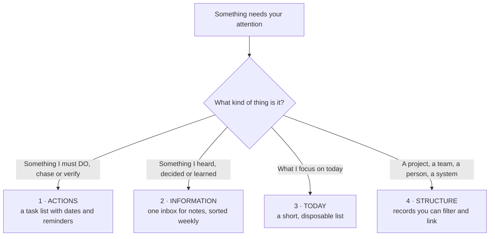

| Kind | Question it answers | What the place must do | In this guide | Could also be |
|---|---|---|---|---|
| **Actions** | What do I need to do, chase or verify? | Add a task in seconds on a phone, with a date and time typed in plain words; remind you at that time; search | Todoist | Any task manager or reminders app with those properties |
| **Information** | What did I hear, decide or learn, and where do I look it up? | Add one line in seconds; search by whole words; optional fields (team, tags); filtered views | A Notion database called **Notes** | Any notes app or spreadsheet with search and filters |
| **Today** | What am I focusing on today? | Work without notifications or email; disposable | A paper notebook | A plain text note, a whiteboard, an index card |
| **Structure** | What are my projects, teams, people, systems — and how do they link? | Records with fields, filters and links between them | Notion databases | A database or notes tool with relations (check each product's free-plan limits) |

The alternatives are examples of *categories of tool*, not tested recommendations. What matters is that each place can do what is in the third column.

### The loop

Capture is instant and unsorted. Sorting happens once a week, in batch.

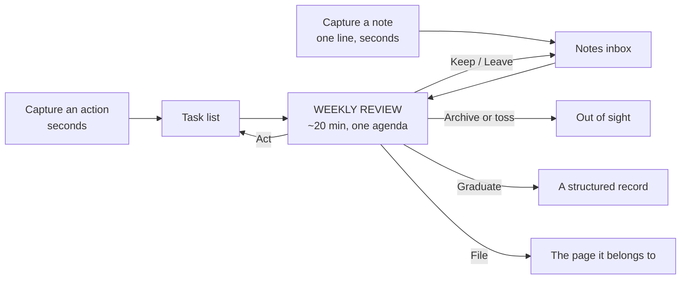

### Eight ideas that make it work

1. **Capture without classifying.** Writing it down must cost seconds. Deciding where it belongs happens later, in batch.
2. **Two inboxes, not one and not twelve.** Actions in one, information in the other. A note is never a to-do, and a to-do is never a note.
3. **One home per thing; link by name, don't copy.** If the real data lives somewhere else (a ticket, a dashboard), keep the definition and a link.
4. **Name things in whole words.** Titles that stand alone, and a project is referred to by its own name wherever it appears. That one habit lets search do the filing for you.
5. **The weekly review is the engine.** One regular meeting with yourself, with a fixed agenda and a time limit. Without it, every inbox becomes a graveyard. A shorter minimum version exists for bad weeks.
6. **Every note ends somewhere.** Each note, on its way through the review, gets one fate: *act* on it, *keep* it, *file* it into the page it belongs to, *graduate* it into a record, or *archive/toss* it. Nothing ages in the middle.
7. **Structure is earned.** Start with a handful of databases. A new one appears only after the same kind of note has shown up three times (the rule of three).
8. **Limit commitments by looking, not by caps.** Each review includes a quick capacity check, and one protected block of time each week goes to the thing that matters most.

The evidence and reasoning behind each is in [Design principles](#design-principles).

### What to look for in any tool

Before you adopt a tool for a role, check it against the list for that role. If it fails an item, you will feel it within a week.

| Role | Must have | Nice to have |
|---|---|---|
| Actions | Quick add from the phone's home screen; natural-language dates and times; reminders at a time; search; recurring tasks | Saved filters; subtasks |
| Information | One-line capture in two taps or fewer; whole-word search; a team/tag field; filtered views; works offline | Relations to other records; a page body for each note |
| Today | No notifications; nothing to maintain | Room to draw |
| Structure | Records with fields; filters and views; links between records | Templates for new records |

### Start small

You do not need the whole guide on day one.

| When | Set up |
|---|---|
| **Week 1** | The task list with a few saved filters; the Notes inbox; the weekly review (agenda in Part 10) |
| **Week 3** | A Projects database and a Teams database (needed to link notes to teams) |
| **Later** | Persons, 1:1 Meetings, Meetings — the six core databases in all |
| **Only when needed** | Optional databases (Part 9) — each one only after the rule of three says so |

### How to read the rest

Parts 1–3 are the three places you capture into (Todoist, notebook, Notes). Parts 4–9 are the Notion side: organization, structure, schemas, optional databases. Part 10 is the weekly review and the daily rhythm. Part 11 is a checklist for designing any database. Part 12 points to the filled-in example. If you use other tools, read each Part as a description of *what the place does*; the tool names are the reference implementation.

---

## The reference implementation at a glance

Most productivity systems collapse because one tool is asked to do everything — a Notion workspace that tries to be a task list, a knowledge base, and a daily planner at once ends up mediocre at all three. This system avoids that by giving each tool a single, non-overlapping responsibility:

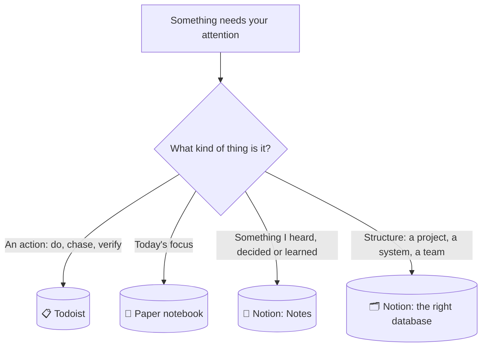

| Tool | Answers the question | Time horizon | Governing framework |
|---|---|---|---|
| **Todoist** | What do I need to *do*, *chase* or *verify*? | Now / this week | GTD |
| **Paper notebook** | What am I focusing on *today*? | Today, disposable | — |
| **Notion** | What did I *hear, decide or learn* — and what do I need to look up? | Months / years | PARA |

| If it's... | It goes to | Example |
|---|---|---|
| An action, a reminder, a follow-up | Todoist | `Chase Ana for replication lag numbers (DB migration)` |
| One of today's three priorities | Notebook (shortlist from Todoist) | `□ Verify rollback test passed` |
| Something heard, decided or learned, in one line | Notion → Notes | `Atlas: cutover rehearsal needs a 4h freeze window (DB migration)` |
| A project, a system, a team, a roadmap item | Notion → its own database | A row in Projects DB |
| Notes taken *inside* a scheduled meeting | Notion → that meeting's page | A dated entry in "Platform weekly sync" |

The routing rule is simple: if it's an action, it goes to Todoist. If it's today's focus, it goes to the notebook. If it's information, it lands in Notes first and gets organized once a week. Structure — projects, systems, teams — lives in its own database.

How the pieces move, end to end:

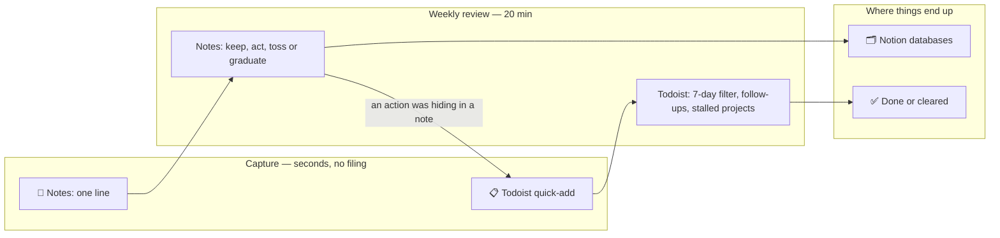

---

## Design principles

Eight rules explain every choice below. Each one comes from the GTD and second-brain literature, from research, or from the limits of the free tiers of Todoist and Notion.

| # | Principle | In practice | Evidence |
|---|---|---|---|
| 1 | **Capture without classifying** | One drop zone per kind of thing. Where it lives is decided later, in batch. | GTD's capture rules: few capture points, emptied regularly [1]; a default "drop zone" so you never debate where something belongs [7] |
| 2 | **Two inboxes, not twelve** | Actions → Todoist. Information → Notes. The notebook is for focus, not capture. | Action items go to the task manager, notes to the notes app [5]; minimize capture locations [1] |
| 3 | **One home per thing** | No task in Notion, no knowledge in Todoist, no checklist that mirrors a plan. | Mirrors of a plan drift out of sync the first time the plan changes |
| 4 | **Search before structure** | Write titles that stand alone; add structure only where search fails. | IBM field study: people who filed into folders were not more successful at finding things [9]; retrieval is mostly opportunistic [10]; "only organize what search cannot find" [11]; organize only when retrieval failed [7] |
| 5 | **Name the project, don't code it** | The project's own name, in the words you use, appears in Notion, Todoist and Notes alike — one search finds everything. No codes to memorise. | Plain text in titles needs no schema to maintain; a code you must recall is friction at capture |
| 6 | **A database must earn its place** | Notes → tag → filtered view → database, in that order (Part 5). | Forte's golden rule (Part 4); Part 11, principle 7 |
| 7 | **One weekly review, about 20 minutes** | One meeting with yourself, one agenda; slower checks are add-ons to it, never separate habits. | The weekly review is GTD's critical success factor — and where it most often breaks down when it gets long [1] |
| 8 | **Link, don't copy** | Metrics, incidents and tickets live in their own tools; Notion holds the definition and the link. | A copied number is out of date the next day |

---

## Part 1 — GTD in Todoist: capture with (almost) zero friction

### What GTD actually says

David Allen's *Getting Things Done* is built on one observation: anything that has your attention but isn't captured in a system you trust creates background stress — what Allen calls an "open loop." The method closes those loops through five stages:

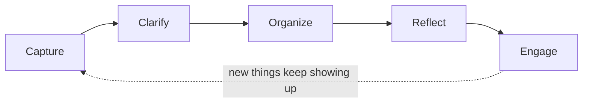

| Stage | What it means | Where it happens in this system |
|---|---|---|
| **Capture** | Collect everything that has your attention, immediately, without judging it | Todoist quick-add (actions) · Notes, one line (information) |
| **Clarify** | Decide what each captured item actually means and what the next physical action is | Verb-first task naming (below) · a team prefix on notes |
| **Organize** | File the clarified item where it belongs | Three containers + the project name in the title (below) · Friday triage of Notes (Part 3) |
| **Reflect** | Review the system regularly so you keep trusting it | Daily notebook ritual + weekly review (Part 10) |
| **Engage** | Choose what to do right now with confidence | Three saved filters (below) |

### Capture: the step Todoist is built for

The entire value of GTD's capture step depends on friction being close to zero. If jotting something down takes more than a few seconds, you stop trusting yourself to do it consistently — and the moment you stop trusting the capture step, the whole method quietly falls apart, because things start living in your head again.

Todoist is used here purely as a capture-and-action engine: quick-add from any device, reliable notifications. It deliberately does **not** try to hold knowledge, context, or history — that is what Notes and the Notion databases are for (Part 3). That discipline is what keeps capture fast.

**Smart Date Recognition** is what makes this concrete. Typing `Schedule vendor meeting #Work-General tomorrow at 8` into the quick-add box in one go creates a task named "Schedule vendor meeting," filed under `#Work-General`, due tomorrow at 8am — three fields filled from a single continuous line of typing, no extra clicks, no switching to a date picker mid-thought. The hyphenated project name isn't cosmetic: Todoist's quick-add reads `#ProjectName` up to the next space, so a name with a space in it breaks this one-line capture — the same reason `Work-General` and `Work-Projects` are hyphenated rather than "Work General."

A project-related capture looks the same, with the project name (below) at the end of the title: `Verify rollback test passed in staging (DB migration) #Work-Projects Wed p1`.

The project and the date are both optional, not habitual: type `tomorrow at 8` only when there's a real time constraint, and leave it off otherwise — an undated task simply sits on whichever container it's filed under until it's picked up during a normal pass. Forcing a due date onto something that doesn't have one yet is false precision, the same trap avoided for Projects' Target and Roadmap's Year (Part 6), just one level further down.

### Clarify: verb-first naming forces the decision at capture time

GTD defines a "next action" as a physical, visible activity — not a topic, not a vague intention. A task named **"Vendor meeting"** is ambiguous within a few days: was it to schedule the meeting? prepare for it? just show up? A task named **"Schedule vendor meeting"** never loses its meaning, because the verb *is* the clarification GTD asks for.

| Instead of | Write |
|---|---|
| Vendor meeting | Schedule vendor meeting |
| Cluster upgrade proposal | Review cluster upgrade proposal (k8s-upgrade) |
| Roadmap slides | Update roadmap slides |
| Waiting for Ana's numbers | Chase Ana for replication lag numbers (DB migration) |
| Did the rollback test pass? | Verify rollback test passed in staging (DB migration) |

A small, stable vocabulary of verbs keeps tasks scannable. Two of them carry most of the weight for commitments:

| Verb | Means | Typical home |
|---|---|---|
| **Verify** | Check that something someone else owns was actually done | `#Work-Projects` |
| **Chase** | You are waiting on someone; this is the date you'll follow up (see Follow-ups below) | `#Work-Projects` or `#Work-General` |
| Draft · Review · Prepare · Decide | You produce or judge something | `#Work-Projects` |
| Email · Mention · Ask · Book · Schedule · Send | A light, quick action | `#Work-General` |

This single habit — always start with a verb — does most of the "Clarify" work for you, right at the moment of capture, so nothing sits half-formed on the list.

### Organize: three containers, split by attention level

Todoist's "Projects" feature just means a simple container here — a folder to file a task into, nothing more. That's different from "a Project" in the GTD or PARA sense (a multi-step initiative with a defined outcome and an end date), which lives in Notion instead (Part 8). The word never carries that heavier meaning inside Todoist.

The split between the two work containers follows one question — **what happens if I forget this?**

| Container | Attention level | What goes in | If you forget it... |
|---|---|---|---|
| `#Personal` | — | Anything outside work | — |
| `#Work-General` | Light | Reminders: talk to someone, send an email, mention something, book a room | Little breaks |
| `#Work-Projects` | High | Commitments and verifications: things that must be delivered, checked or chased for a project | Something breaks, or someone is let down |

And the rule that makes it mechanical, so nobody has to judge "is this important enough?" at capture time:

> **Is it part of a project I track in Notion, or a commitment I must not drop?** Yes → `#Work-Projects`, with the project name at the end of the title. No → `#Work-General`.

Short enough to use as each Todoist container's own description field:

| Container | Description |
|---|---|
| `#Personal` | Anything outside work |
| `#Work-General` | Light reminders, no project |
| `#Work-Projects` | Commitments and checks — project name at the end of the title |

Three containers, all flat. No sub-projects, no nesting. The free plan allows five active personal projects [25][27], so this leaves two spare. No Labels are used at all: the project name in the title does the job a label would, as plain text, with no schema to maintain. A delegated or stalled task is caught by the `Chase` convention and the Friday review instead (below, and Part 10).

### The project name in the title

There is no code to memorise. A task, a note and a Notion project are linked by nothing more than **the project's own name, written the way you would say it**, in brackets at the end of the title: `(DB migration)`, `(CI revamp)`.

| Where | How the name appears |
|---|---|
| Notion → Projects DB | The row's name *is* the project name: `DB migration` |
| Todoist → task titles | At the end: `Prepare cutover runbook (DB migration)` |
| Notion → Notes titles | At the end, when the note is about that project: `Cobalt: new runner images land Nov 3 (CI revamp)` |

Search then does the grouping:

| Search for `migration` in... | Returns |
|---|---|
| Todoist (search bar, or `search: migration`) [26] | Every open task whose title contains the word, across both work containers |
| Notion (search) | The project row, and the notes and meeting entries that mention it |

Rules, kept deliberately loose:

- **Use words you would naturally type.** Any whole word from the project's name works as a search term, so you never need to remember an exact code. Search in Notion matches whole words only (tested), so `migration` finds `DB migration`; a fragment such as `migr` would not.
- **Forgot the name? Don't stop.** Capture the task without it (`#Work-General` if unsure) and add the name at the weekly review, or search a word you remember from the task. The Projects database, one of your Favorites, is the list of names.
- **Renaming a project costs only search grouping.** Old titles stay readable; they just stop appearing under the new word.
- A system or ongoing area may get a name too (`Core DB`, `Compliance`) if you keep writing it in tasks and notes. If it has none, nothing breaks.
- There is no link *from* Notion *to* Todoist. Nobody opens a project page wondering which tasks exist; they open Todoist and search the name (Part 11, principle 7).

> **[Assumption to verify]** Todoist documents `search:` with a single keyword [26]. A word inside brackets in a title should match as plain text, but this hasn't been confirmed in-app. Test it once with a real project before relying on it.

### Subtasks: decompose a task, never mirror a plan

Subtasks answer one question: *what are the steps of this one concrete task?* They never answer *what is the plan for the project?* — the plan is text in the Notion project page (Part 8).

| Use subtasks when | Don't, when |
|---|---|
| The task has three or more genuinely distinct steps | The steps are completely predictable and sequential — just rename the task to the next step [36] |
| Steps have different due dates or different people | You'd be pre-loading the project's later phases |
| You're about to start the task | The project is still `Next` or `Later` |

Rules that keep this light:

- **Create subtasks when you start the task**, not in advance. A pre-loaded stack of subtasks is a second copy of the Notion page, and the two drift apart the first time the plan changes.
- A step that needs more than a day, its own deadline, or another owner becomes a **standalone task** with the project name.
- Todoist caps active tasks per Todoist project at 300, sub-tasks included [25] — plenty, but a reason not to hoard.
- The free plan includes subtasks [40].

> **[Assumption to verify]** Whether subtasks accept their own due date on the free plan hasn't been confirmed in-app.

```
☐ Prepare cutover runbook (DB migration)              due Fri
    ☐ Collect failover steps from Ana
    ☐ Draft the runbook
    ☐ Review with the Atlas on-call
```

### Follow-ups: the Waiting For list without labels

GTD keeps a *Waiting For* list for everything you depend on someone else for [3][4]. The practical trick that works in any task manager: record the follow-up as a next action with a due date — the date you'll check, not the date you expect the result [3].

In this system that is a task starting with **`Chase`**:

| Situation | Task |
|---|---|
| You asked Ana for numbers | `Chase Ana for replication lag numbers (DB migration)` — due the day you'll ask again |
| Waiting on a vendor | `Chase Vendor X for the audit report (Access review)` |
| You delegated a doc | `Chase Elena for the template spec draft (CI revamp)` |
| Something small, no project | `Chase facilities about the room booking` (in `#Work-General`) |

When the thing arrives, close the task. When the date comes and it hasn't, the task is your nudge — send the message and move the date. No `@waiting` label is needed: the third saved filter (below) lists every `Chase` task in one place, and the Friday review scans it.

### Priority: only when it's actually true

Todoist has four priority levels, and `P4` — no flag at all — is the state every task starts in. It should stay that way for almost everything. Mark `P1`, `P2`, or `P3` only when something is genuinely more urgent than the rest of the list, typed inline the same way as a project tag or a date (`p1` while capturing sets it directly). Applied as a habit to every task, priority would just recreate the "everything is important" noise it exists to cut through — most days, nothing gets flagged, and that's the system working, not something missing.

This doesn't compete with the Big 3 (Part 2). Big 3 is which three things get today's attention, decided fresh each morning; Priority is a property on the task itself, useful the moment you're scanning a longer list and want the genuinely urgent items to stand out from everything that's merely due.

### Engage: three saved filters, pinned to the top

- **Today** — query `overdue | today`. Includes anything overdue, not just what's freshly due — the morning pick should never miss something that slipped.
- **Due in 7 days** — query `due before: in 7 days`. This catches overdue items too: anything with a due date before "7 days from now" includes everything already late. A plain "next 7 days" filter would miss those — a task quietly slipping past its date shouldn't fall out of view.
- **Follow-ups** — query `search: Chase`. Every open `Chase` task, whatever its date: the Waiting For list, with no label to maintain.

The free plan allows exactly three saved filters [26][27], so these three use every slot. Everything else is a search-bar query (a project name, a person) — which is how this system is meant to be used anyway. A saved filter trades a repeated mental query for a single tap.

### Optional: the parent-task pattern for crowded projects

By default there is **no** parent task per project: tasks carry the project name and search groups them. The older pattern — one undated parent task per `Now` project in `#Work-Projects`, holding subtasks — is kept as an option for the rare project that has **five or more open tasks in parallel** and needs them grouped on screen.

If you use it, keep its rules tight:

- Only for `Now` projects; created when Status moves to `Now`, checked off when it moves to `Done`.
- The parent task never has a due date; dates live on its subtasks, and only when real.
- Named after the project (the one exception to verb-first); the Notion page URL goes in its description.
- Friday check: the parent still has a live subtask, and it's checked off if the project turned `Done`.

The cost is a second place to keep in sync by hand (create, check off, strip dates when the project goes `On Hold`). That cost is why this is not the default.

### Example

```
#Work-Projects
☐ Verify rollback test passed in staging (DB migration)      Wed  p1
☐ Ask Cobalt for a 4h deploy freeze before rehearsal (DB migration)   Tue
☐ Prepare cutover runbook (DB migration)                     Fri
    ☐ Collect failover steps from Ana
    ☐ Draft the runbook
    ☐ Review with the Atlas on-call
☐ Chase Ana for replication lag numbers (DB migration)       Tue
☐ Chase Elena for the template spec draft (CI revamp)        Fri

#Work-General
☐ Email Ana about the offsite agenda                          today
☐ Mention the freeze window to Team Beacon at Thursday sync   Thu
☐ Book a room for quarterly planning

#Personal
☐ Book car service appointment                                Sat
```

Four things to notice. Every `#Work-Projects` title ends with a project name and every `#Work-General` title doesn't — that's the whole routing rule. Subtasks appear under exactly one task, the one being worked on. Both `Chase` tasks have the date of the *next nudge*. And priority appears once: most days, nothing is flagged.

---

## Part 2 — The Notebook: today's focus, made disposable

### Philosophy

The notebook exists to answer one question: what am I focusing on *today*? There is no index, no migrating unfinished items to a new page, no reviewing last week — every page is meant to die at the end of the day. That's a deliberate choice, not a limitation: a system that requires looking backward carries more overhead than this use case justifies.

> **Why paper, in the author's own experience:** the notebook is a place to work and think *away from the computer*, with no email and no notifications competing for attention, so the work is more focused. Writing by hand also allows quick drawings and diagrams. These are personal observations, not research claims — which is why the notebook stays regardless of the duplication it costs.

### The "Big 3"

Three items, picked each morning straight from Todoist's Due in 7 days filter — which also surfaces anything overdue, so nothing that slipped gets missed — written down as today's focus. This is a **shortlist**, not a second place where tasks live: the task itself still exists, and still gets completed, in Todoist. The notebook just spotlights three of them so the day has a clear center of gravity instead of a scrolling list.

The notebook is not a capture point either. A thought that arrives mid-day goes to Todoist (if it's an action) or to Notes (if it's information) — never onto the page, where it would die with it.

### Symbols — kept to a minimum, but expressive enough

The creator of the Bullet Journal method, Ryder Carroll, is explicit about this: *"keep custom bullets and signifiers to an absolute minimum — the more you invent, the more complex it is, and the slower you become."* This system uses exactly four:

| Symbol | Meaning | Written |
|---|---|---|
| `□` | Picked from Todoist this morning, not resolved yet | Morning |
| `✓` | Done — also checked off in Todoist | Evening |
| `→` | Still open — stays in Todoist as-is, just not today | Evening |
| `✕` | No longer needed — cleared from Todoist too | Evening |

The arrow and the cross separate two different reasons a shortlisted item doesn't close out. `→` means it's still a live Todoist task, simply not today's — there's nothing to *do*, it stays exactly where it already was and can get picked again tomorrow if it's still relevant. `✕` means the opposite: the task itself is done for, and that needs to be reflected back in Todoist too, or it'll keep resurfacing on a list it no longer belongs on. Either way, Todoist stays the single source of truth for which tasks exist — the notebook only ever tracks how today's chosen three went.

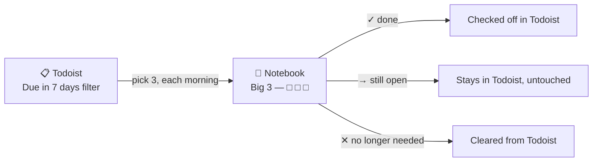

The notebook never holds a task Todoist doesn't already have — every arrow out of the Big 3 either closes, leaves alone, or clears the same task back in Todoist. Nothing new gets created on the notebook side.

### An optional addition: drafting tomorrow

**One line drafting tomorrow** — at the end of the day, optionally write one likely item for tomorrow's Big 3. It removes the "blank page" friction the next morning, for a cost of about ten seconds. This isn't a core habit like the symbols — skip it on any day it doesn't come naturally; the only thing that matters is that today's page still dies at midnight either way.

### Example page

```
Wednesday, October 28
─────────────────────────────────────
BIG 3
✓  Verify rollback test passed in staging (DB migration)
→  Prepare cutover runbook (DB migration)
✕  Book a room for quarterly planning (moved online — cleared from Todoist too)
- - - - - - - - - - - - - - - - - - -
Tomorrow, maybe: chase Elena for the template spec draft
```

All three items started the morning as `□` — three tasks pulled straight from Todoist's Due in 7 days filter. By evening, one is finished (and checked off in Todoist too), one simply didn't happen and stays exactly where it already was, and one no longer applies at all, which gets cleared out of Todoist so it doesn't linger. The last line is the optional draft for tomorrow — present here, skippable on any other day.

---

## Part 3 — Notes: the information inbox

### Why a second inbox

Todoist captures *actions*. But a large share of a manager's day isn't actions: a fact someone mentions about a system, a process that changed, a decision made in a corridor, a risk that surfaced in passing. In the first version of this system those had one answer — "Notion, in the right database" — and that was the weak point: choosing the database while the person is still talking is exactly the kind of decision that makes capture fail. Information either got lost or got written somewhere nobody could find again.

The fix follows two rules from the literature. GTD says to **minimize capture locations** and empty them regularly [1]. Building a Second Brain says to **capture first and organize later**, and is explicit about the split: action items go to the task manager, notes go to the notes app [5][7]. So the system has exactly two inboxes — Todoist for actions, **Notes** for information — and the notebook stays what it is (today's focus, never capture). Engineering managers describe the same habit: the more effective ones diligently make notes and review them daily and weekly [24].

| | Todoist | Notes (Notion) |
|---|---|---|
| Holds | Things to do, chase, verify | Things heard, decided, learned |
| One item is | A task with a verb | A one-line row with a title that stands alone |
| Organized by | Container + project name | Team + search (and tags, sometimes) |
| Cleared when | Done | Never — it's a record; only tossed notes are deleted |
| Reviewed | Daily (filters) + Friday | Friday triage (≤ 5 min) |

### What counts as a note

| Kind | Example title | Tag (optional) |
|---|---|---|
| Fact about a system | `Beacon: warehouse nightly load now takes 3h, was 1h (warehouse)` | `system` |
| Process change | `Cobalt: new runner images land Nov 3, expect a flaky week (CI revamp)` | `process` |
| Decision | `Decision: all new services publish to the Event Bus (Event Bus upgrade)` | `decision` |
| Risk | `Risk: only one person knows the legacy scheduler setup` | `risk` |
| Technical debt | `Atlas: Kubernetes is two minor versions behind` | `debt` |
| Metric reading | `Cobalt: build cache hit rate dropped to 55% (CI revamp)` | `metric` |
| Idea | `Idea: weekly 15-min "ask the platform" office hours` | `idea` |
| Vendor or external | `Vendor X renewal due Jan 15, pricing +20% (Access review)` | `vendor` |
| Planning input | `Quarterly planning: Cobalt wants CI templates in H1 (CI revamp)` | `planning` |

Tags are optional and loose (a multi-select: none, one or several; new ones invented on the spot). Nothing is required at capture.

### Capture rules

1. **One line.** If it needs a paragraph, write the line now and the paragraph in the page body later — every row is a full page underneath.
2. **Team first**, as a prefix: `Atlas: ...`. Cross-team or unknown → no prefix.
3. **Project name last**, when the note is about a project or system.
4. **A title that still makes sense in three months** — who or what, not "check this".
5. **No tags, no relation, no properties at capture.** Triage fills them in.
6. **If it's an action, it's a Todoist task, not a note.** If it's both, the task wins; the note is optional.
7. **Notes taken inside a scheduled meeting** go on that meeting's page, not here. Everything from the corridor, a chat or an unplanned call → Notes.

| Weak | Strong |
|---|---|
| `Talk about the freeze` | `Atlas: cutover rehearsal needs a 4h freeze window (DB migration)` |
| `Kafka thing` | `Decision: all new services publish to the Event Bus (Event Bus upgrade)` |
| `Remember to check cache` | *(that's an action)* → Todoist: `Verify build cache hit rate recovered (CI revamp)` |
| `Ana said something important about the DB` | `Atlas: Ana flagged replication lag spikes at month-end (DB migration)` |

### Capture paths

The target is **under ten seconds from unlocking the phone to typing**. If a path misses that consistently, the path is wrong, not the method.

| Where | Path | Taps |
|---|---|---|
| **Android** (primary) | Notion **Page widget** pointed at the Notes database: long-press the Notion icon → *Widgets* → drag to the home screen → tap it and choose the Notes database [31]. Then widget → **New** → type. Put it on the first home screen | Widget → New → type |
| Android (backup) | The **Favorites** widget (Notes is the first Favorite), or the app's own Notes entry | App → Notes → New |
| iPhone | Same widget (added from the "+" on the home screen, then *Edit Widget*) [31]; or a Shortcuts automation using Notion's "add page to database" action, pointed at Notes [34] | Widget → New → type |
| Desktop | Notes is the first Favorite; or a browser bookmark to the database | 1–2 clicks |
| Offline | Mark the Notes database "Available offline" | — |
| Optional | A page with a button whose action is "Add page to Notes" [30] | Widget → button → type |

> **[Assumptions to verify]**
> - Notion's help says database buttons exist on all plans, but that some *actions* are paid-only [30]. The text retrieved doesn't make clear whether "Add page to" is one of them — test it on the free plan. If it isn't available, the widget → **New** path above needs nothing paid.
> - The Shortcuts action (iPhone only) and its setup come from tutorials that are a couple of years old [34] — confirm it still exists in your Notion version.
> - On Android, Notion's help confirms the Page widget (a page or a database) and the Favorites widget [31], but doesn't describe a quick-note or "add to database" widget action, and I found no share-sheet capture path. So the Android path is widget → open Notes → **New**: two taps instead of one. Whether the widget lands directly on the database (so **New** is one tap away) is unverified — test it. Android automation apps (such as Tasker) are an untested alternative.
> - Third-party capture apps for Notion exist, but they require access to your workspace. If these notes concern work, check your company's rules first.

### Views

| View | Filter and sort | Opened |
|---|---|---|
| **Recent** (default) | Created in the last 30 days · **Archived** is unchecked · newest first | Daily |
| **No team** | Team is empty | Friday triage |
| **By team** | Board grouped by Team · **Archived** is unchecked | When preparing for a team |
| **Ideas** | Tags contain `idea` · **Archived** is unchecked | Quarterly |
| **Review** | Team is set · **Archived** is unchecked · created **30–37 days ago** · oldest first | Weekly (see below) |
| **All** | No filter (archived notes included) | A rare full audit; search also finds archived notes |

Only the first view is ever the default: an unfiltered view of thousands of rows is the one thing to avoid (see *How big can it get?*).

### Friday triage: four outcomes

Open **No team** and give each row exactly one fate. About five minutes, inside the weekly review (Part 10).

| Outcome | When | What you do |
|---|---|---|
| **Keep** | Information worth finding later | Set Team (and a tag if it helps). Cross-team notes get the team `Org-wide`, so every kept note has a team and leaves the queue. It gets one more look in the weekly notes review (below). |
| **Act** | It was hiding an action | If it takes under two minutes, just do it now — the two-minute rule belongs to the clarify step, not to capture [2]. Otherwise create the Todoist task, and delete the note unless it also holds lasting information |
| **Toss** | You know you'll never look at it again | Delete it |
| **Graduate** | It belongs to something structured | Move it into a database or onto a page — see the ladder in Part 5 |

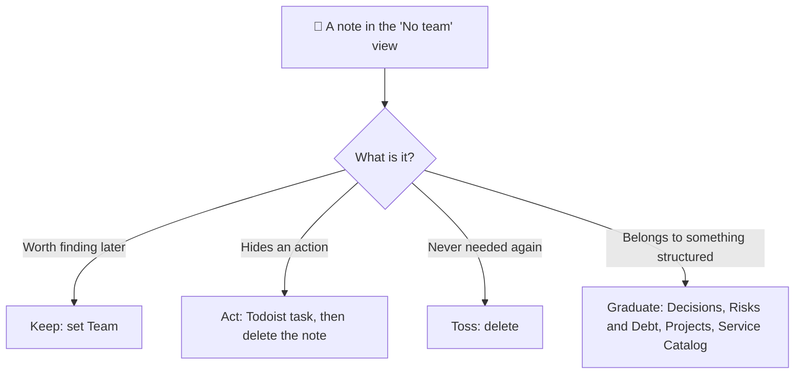

A note on cadence. Ahrens's slip-box method asks for a pass over fleeting notes within a day or two, because a pile of unprocessed fleeting notes is just clutter [8]. This system uses a weekly pass instead, because most work notes are *reference* — a fact, a date, a decision — not raw ideas that need developing. If the **No team** view regularly passes ~30 rows, triage twice a week.

### Weekly notes review: file it or archive it

Friday triage decides what a *new* note is. Nothing so far decides what happens to the notes you **Keep** — and a kept note that is never looked at again is how an inbox turns into a graveyard. So once, about five weeks after it was written, every kept note gets one more look, as part of the weekly review, and one of three fates:

| Fate | When | What you do |
|---|---|---|
| **File** | The information is lasting and belongs somewhere | Copy the line into the page it belongs to, then archive the note. Where: the **team's page** (how the team works, priorities), the **project page** (Context or Decisions), the person's **1:1 page** (the NEXT block), a **meeting page**, a **Resources** page, or — if you have created it — a **database row** (a service's *Known limitations*, a Decision, a Risk) |
| **Leave** | Still useful, nowhere better to go yet | Do nothing. It stays in Notes under its team |
| **Archive** | It no longer makes sense (done, outdated, replaced) | Tick **Archived**. It disappears from every view except *All*, but search can still find it |

Notes:

- **The Review view is a one-week slice** (created 30–37 days ago), so each note comes up exactly once without any "reviewed" marker. If you skip a week, widen the window to 30–44 days once.
- **Archive is a checkbox, not a move.** Notion has no archive state for database rows other than the trash, so a checkbox keeps the note recoverable and findable. A checkbox is better than a tag here: it cannot be misspelled, and every view can filter on it reliably. Delete only what is pure noise (that is the **Toss** outcome on Friday).
- **File, don't re-type.** The line is usually one sentence; paste it under a dated heading on the target page. The page now holds the fact, so the note has done its job.
- **Time:** about five minutes for the 35–70 notes in a one-week slice (at 5–10 notes a day). It is one line of the weekly review agenda (Part 10).
- This is also the answer to "where do notes go to die?": either into the structure (File) or out of sight (Archive). Nothing is left to age in the middle.

### Finding things later

Three routes, none of which requires you to have filed anything carefully:

| You want | Do |
|---|---|
| Anything about a topic | Notion search for a whole word: the project, the system or a name — titles are written to be found |
| What's new for a team | The **By team** view, or open the team's page in Teams: related notes appear there automatically (Part 7) |
| All notes of one kind | Filter by tag (`decision`, `risk`, `idea`) — or, once it exists, the dedicated database (Part 9) |

> **Observed limitation (tested in-app):** Notion search did **not** find a note titled "test" when searching "tes". Notion's help doesn't document partial-word matching either way. Treat search as **whole-word only**: type complete words, and write titles with the full word (`warehouse`, not `wh`), so that the word you will remember later is literally in the title. One capital letter or abbreviation you never type again is a note you won't find. Because project names are written as ordinary words, this mostly stops mattering. One test worth doing once: whether a view filter "Title contains" matches part of a word — if it does, that is the fallback for partial searches.

Why not file carefully at capture? In a field study of 345 email users and 85,000 re-finding actions, people who invested in folder structures were no more successful at finding things than people who searched; search and threading worked at least as well [9]. The oft-quoted "search is 3.4× faster" compares single operations; end to end the gap was small (roughly 66 vs 73 seconds) — but the filing itself costs extra time on top [10]. Email isn't notes, so treat it as supporting evidence, not proof; the practical rule that follows is the same one other practitioners reach: organize what search cannot find [7][11].

### How big can it get?

At 5–10 notes a day over roughly 230 working days, that is **1,150–2,300 notes a year**, so 5,000 notes is two to four years away. A Notion database can hold up to 250,000 rows [29], and a free workspace with one owner has unlimited blocks (the 1,000-block ceiling applies only to workspaces with two or more owners) [33]. The risk is not the limit but loading a huge unfiltered view: keep the default view filtered to the last 30 days and open **All** only for an audit. That last point is an inference — no measurement of a 5,000-row notes database was found.

### What does not go in Notes

| Not a note | Goes to |
|---|---|
| An action | Todoist |
| Anything said inside a scheduled meeting | That meeting's page (Part 8) |
| Performance feedback, wins or concerns about a person | That person's 1:1 page — and check your company's rules about where such information may be stored |
| Credentials or secrets | A password manager |
| Real data that has its own source of truth — metrics, tickets, incidents | The tool that owns it; Notes keeps a link and a one-line reading |

---

## Part 4 — PARA in Notion: organizing by actionability, not topic

### Origin, and how it relates to GTD

PARA comes from Tiago Forte's *Building a Second Brain*, where it is the "Organize" step of a larger loop called **CODE** — Capture, Organize, Distill, Express [5][6]. That parallels GTD's own Capture step neatly: GTD governs the flow of *actions* (handled by Todoist, Part 1); PARA governs the structure of *knowledge* (handled by Notion, this part and onward). The two frameworks aren't competing — they cover different halves of the same problem. Notes (Part 3) is where Capture happens for knowledge; the databases are where it lives once it has earned a home.

### Four categories, ordered by actionability

PARA's central move is to file things by **how actionable they are right now**, never by subject. The question is never "what is this about" — it's "how ready for action is this":

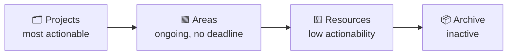

| Category | Definition | Example |
|---|---|---|
| **Projects** | A defined outcome with an end date, spanning multiple work sessions | "Migrate the core database to a managed provider" |
| **Areas** | An ongoing responsibility with no end | "Team Atlas operations" |
| **Resources** | Reference material or an interest, with no responsibility attached | "Failover runbook" |
| **Archive** | Everything else — out of sight, not deleted | A finished project, a defunct system |

Items **flow** between categories over time: a Resource can become a Project the moment you decide to act on it; a Project becomes Archive when it's done; an Area can go inactive and move to Archive.

> **The golden rule** (Tiago Forte's own words): never create an empty folder, tag, or database before you have real content for it. Structure built "for later" before it's needed is the single most common mistake in systems like this — and the easiest one to avoid.

### Why PARA fits Notion specifically

Notion has a quiet structural feature that makes it a very good fit for PARA: **every database row is, under the hood, a full page.** You are never forced to choose between "structured list" and "rich freeform content" — a row can have filterable properties *and* an open canvas of notes, exactly the two things PARA needs (structured Projects/Areas plus freeform pages for narrative and context).

### Closing things out: when "Archive" means a status, not a move

Forte's original model treats Archive as a place you move things to — a Project finishes, its page gets dragged into an Archive folder. That works for plain pages, but a *database* like Projects already has something a folder doesn't: a Status field that can represent "finished" on its own. Physically removing a completed row would throw away exactly the structure that makes it worth keeping — its Team, its history, its Tracker link, all still queryable.

The better move for anything backed by a database: **let a Status value do the archiving, and split the view instead of moving the row.**

- Projects already has a `Done` status. One view filters it out (`Status is not Done`) for the day-to-day list; a second view filters for it (`Status is Done`) as a running record of everything shipped — still filterable by Team, still sortable by date, still fully structured.
- Service Catalog works the same way: a system moves to `Deprecated` and disappears from the default working view (`Status is not Deprecated`, which still shows `Legacy` — it's frozen, not gone) without ever leaving the database.
- The same pattern covers the optional databases (Part 9): a decision becomes `Superseded`, a risk becomes `Closed`.

The physical Archive folder is still the right destination for things that *don't* have a Status field of their own to retire into — an Area that stops being relevant, a Resource page that goes stale, anything living as a plain page rather than a database row. For anything structured, the database itself is the archive; a view is just a lens on it.

**Ideas** used to live in their own *Someday / Ideas* database. They no longer do: a Someday/Maybe idea is now a note with the tag `idea` (Part 3), reached through the **Ideas** view and reviewed quarterly. When an idea is acted on, it graduates into a Project — and the Project is the permanent home for that work — so the note is simply deleted. Keeping resolved ideas around would slowly turn a quick-glance list back into something that needs its own review ritual, which is exactly what it was built to avoid.

---

## Part 5 — Database or Page? A decision framework

### The four questions

Every time something new needs a home in Notion, the same four questions decide the format:

| Question | Signal for a Page | Signal for a Database |
|---|---|---|
| How many items, in total? | Few and stable (up to ~8–10) | Many, or growing over time |
| Do they all share the same "shape" (the same fields)? | No — each one is its own world | Yes — the same properties across all of them |
| Do you need to compare, filter, or sort several at once? | No | Yes |
| Is it a structure that repeats often? | Not repetitive | Yes, and duplicating it by hand is annoying |

Rule of thumb: two or more answers on the same side decide it. On a tie, default to what you already have today — migrating from Page to Database later is cheap.

Two corollaries:

- **Two databases with the same shape are one database.** That is why *Someday / Ideas* was folded into Notes: both had a title, tags and a created time.
- **If the real data lives in another tool, it isn't a database here.** Notion holds the definition and the link (Part 9).

> **When to use a Relation instead of a Select:** only when you genuinely need a two-way link (seeing the connection from both sides) or when the same value would otherwise be duplicated across three or more databases, risking them drifting out of sync. Outside of that, a plain Select with a filtered view gives the same value with far less setup.

> **Select vs. Multi-select (Tags):** a Select forces every row into exactly one value from a fixed list — good for a genuine single state (Status, Stage). A Multi-select ("Tags") lets a row carry none, one, or several values, and new ones get added on the fly without touching a schema. When the items don't share a clean, exclusive category but you still want to filter across them, Tags is the looser tool for the job — it adds a filter without forcing a shape.

### From note to database: the graduation ladder

New kinds of information show up all the time: decisions, risks, technical debt, vendor facts. Creating a database for each one *before* it recurs is the premature structure the golden rule warns against — and, worse, it brings back the capture-time question "where does this go?". So every new kind starts at the bottom of a ladder and climbs only when it has earned it.

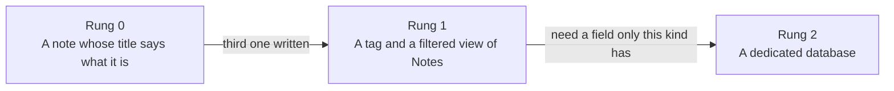

| Rung | What it is | Cost | Climb when |
|---|---|---|---|
| **0** | A note whose title carries the kind: `Decision: all new services publish to the Event Bus` | Zero | You write the **third** one of that kind |
| **1** | The tag `decision` plus a filtered view of Notes | One tag, one view | You want to **sort or filter by a field only this kind has** — Status, Impact, Ring |
| **2** | A dedicated database with that kind's few fields (Part 9) | One database, a handful of properties | — |

The **rule of three** is the trigger for the first climb: the first note of a kind is just a note, the second is a coincidence, the third is a pattern. The second trigger — needing to sort by a field that only that kind has — is what justifies a database. Until then a filtered view of Notes does the job and costs nothing.

To climb to rung 2: create the database from the ready-made schema in Part 9, then move the existing rows over. A database row can usually be moved into another database with matching property names carrying over, but test that with one row first.

> **[Assumption to verify]** Moving a page into another database ("Move to") and which property values survive hasn't been confirmed in-app for this workspace. If it doesn't carry over cleanly, copy the title and paste it as a new row — these are one-liners.

---

## Part 6 — The Notion structure

### Top level and Favorites

Only the four PARA categories sit at the top of the sidebar, collapsed. Daily navigation does **not** happen through them: it happens through **Favorites**, which pin a handful of databases at the top of the sidebar without moving them out of their folders. Classification and access speed are two independent problems; you don't have to trade one for the other.

```
⭐ Favorites (5–6)
   📝 Notes
   🗂️ Projects
   👥 Teams
   📅 Meetings
   🤝 1:1 Meetings
────────────────────────
🗂️ Projects            ← the Projects database itself, not a folder
🟩 Areas
🟨 Resources
📦 Archive
```

Notion's own guidance for a healthy sidebar is the same in spirit: keep it minimal, favorite the pages you visit often, and remove favorites that no longer serve a purpose [41]; keep the list short and let search and recents cover the rest [42]; rotate favorites to match what you are working on [43].

| In Favorites | Not in Favorites — reached through the Teams page, folders or search |
|---|---|
| Notes · Projects · Teams · Meetings · 1:1 Meetings | Persons · Service Catalog · Roadmap · Decisions · Risks and Debt · Technology Radar · Resources pages |

Rules:

- **At most six.** A database earns a Favorite if it is opened at least weekly. Past six, you start "searching within your favorites" [42].
- **Notes is always the first Favorite.** It is the capture point.
- **The Teams page is the second front door.** It rolls up everything linked to a team (Part 7), so the databases that aren't favorites are one click away from it.
- **One slot may rotate** to whatever you're working on this month (a project, a runbook), and goes back afterwards [43].

### Projects

The **Projects** entry at the top level is the **Projects database itself**. There is no wrapper folder: with loose pages retired, a folder holding one database would be an extra click for nothing, and a folder with one item is a sign it shouldn't be a folder.

Loose pages — "project-shaped but too small for a database row" — are retired too. Their job now belongs to Notes: a one-off becomes a note (with a page body if it needs one), and if it ever earns a Status and several work sessions, it becomes a Projects row. Two checks still come first: an action belongs in Todoist, and a meeting belongs in the Meetings database.

| It is... | It goes in |
|---|---|
| Has an end, spans several work sessions, worth a Status | A row in the Projects DB |
| Short-lived and one-off, nothing to track | A note in Notes (with a body, if needed) |
| An action | Todoist |
| A scheduled meeting | Meetings |

### Inside Areas

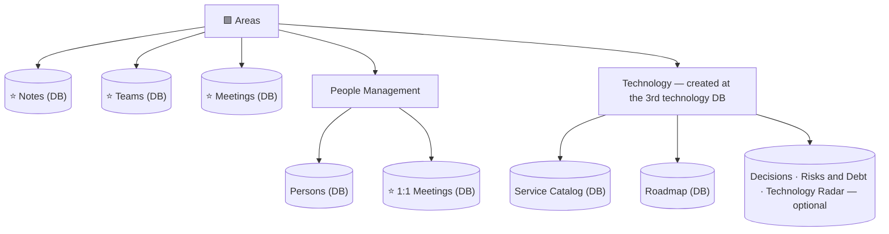

**Why Notes, Teams and Meetings sit directly in Areas, rather than inside one specific team:** none of them has a single owning team — they all serve every team at once. A database that serves several teams doesn't fit physically "inside" any one of them without feeling out of place. The same goes for the technology databases.

**The Technology folder follows the golden rule.** While Areas holds about seven items or fewer, Service Catalog and Roadmap sit directly in it. The folder is created only when the *third* technology database exists (Service Catalog and Roadmap plus any one of Decisions, Risks and Debt, Technology Radar) — and not before.

### Resources and Archive

- **Resources** — commands, guides, house rules, process notes, runbooks, and single reference pages such as *Metrics I watch* (Part 9). Reference material that doesn't expire and has no single owner. There is no Someday/Ideas database any more — ideas are notes tagged `idea` (Part 3).
- **Archive** — whatever is no longer needed, grouped by year. It is never itself a database — always a destination — and, per Part 4, only for things that have no Status of their own to retire into.

### Roadmaps: continuous, not a Project

*Only relevant if you create the optional Roadmap database (Part 9).*

A roadmap looks, at first glance, like it might belong under Projects — "2027 roadmap" sounds like something with a natural year-long arc, an end date built into its own name. But look closer: the *activity* of maintaining a roadmap never actually ends. There's a 2027 one, then a 2028 one, then a 2029 one, indefinitely. That's the same shape as recurring Meetings and 1:1s — not a single event with a finish line, but an ongoing responsibility that keeps producing new instances of itself.

The fix is the same one already used for both: don't create a new artifact every time it recurs. No "Roadmap 2027" and "Roadmap 2028" as separate pages or databases, each starting from zero — one database, accumulating roadmap items across every year, with a field distinguishing which year each one belongs to.

Because a roadmap can span more than one team, it lives directly in Areas (or in Technology, once that folder exists), rather than being folded into any single team's page. Full schema in Part 9 (Roadmap is optional).

A specific year is also often less certain than it looks. Something aimed at "2028" is frequently really just *"later than next year, not worth pinning down further yet"* — forcing a firm Year onto it borrows the same false precision that Now/Next/Later exists to avoid for Projects. The fix is the same one: a `Horizon` field (`This year` / `Next year` / `Someday`) carries the honest, low-confidence version by default, and `Year` only gets filled in once a specific year is a real decision, not a guess dressed up as one.

This is the actionability flow from Part 4 made concrete: a roadmap item starts out closer to a Resource — an idea with more weight behind it than a note tagged `idea`, but nothing committed yet — and crosses into Projects the moment Status flips to `In Progress` and a Related Project gets linked. The Roadmap row doesn't disappear when that happens; it just sits there as the record of *when the idea became real work*, while the Project itself carries the week-to-week execution.

Ideas and Roadmap are two separate on-ramps into Projects, not one pipeline you always pass through — a fully-formed idea can jump straight from Notes to a Project, while a bigger, longer-horizon initiative usually sits in Roadmap first:

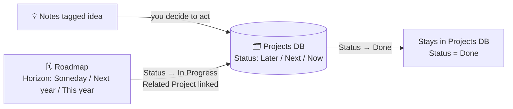

Both arrows into Projects are one-directional and manual — nothing here auto-promotes anything; a person decides each time.

---

## Part 7 — The Teams database: a relational hub

Persons, 1:1 Meetings, Meetings, Projects and Notes each need some notion of "which team" — and so do the optional databases — Service Catalog, Roadmap and the rest (Part 9). Without a dedicated database, that means the same short list of team names duplicated as a Select field in up to ten different places — guaranteed to drift out of sync the moment a team is renamed or a new one appears.

**Teams** solves this: it's the single place where team names actually exist. The other databases point to it through a Relation. Renaming or adding a team happens once, not ten times.

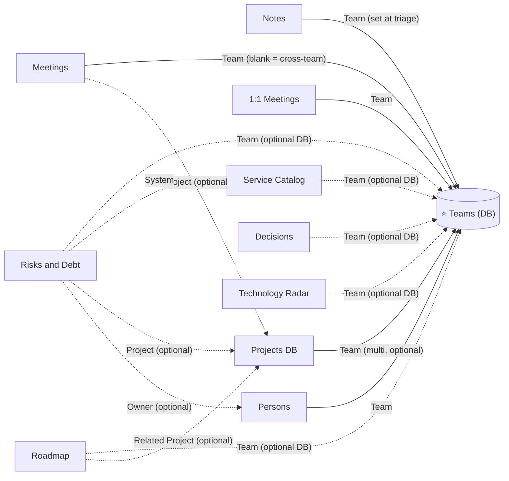

Each row in Teams (say, "Atlas") is a complete page in its own right, and can hold freeform notes about that team. When a Relation is created **two-way** (switch on "show on Teams" when you create it), the Atlas page automatically gains a property for each related database — **Notes**, **Projects**, **Persons** and so on — listing the linked items as clickable titles. That costs nothing and answers "what is linked to this team?". It is only a list: no filtering, no sorting, no hiding of archived notes.

That also makes the Teams page the **second front door** to the workspace: the databases that aren't Favorites are one click from it.

Projects that don't belong to any one team are simply left with the Team field empty — the project's own name usually makes that obvious without needing a category to say so too.

### Optional: a team page with a view per database

If the automatic lists are not enough, you can make the team page show a **filtered table for each database**. This is optional; start without it.

A Notion view shows rows from **one** database only, so there is no single list that mixes meetings, notes and projects [47]. What you can build is a page with several small views side by side, one per database, each filtered to the team:

1. Open the team's page (say, Atlas).
2. Type `/table` and choose **Meetings** as the source, so that you create a *linked view* and not a new database.
3. Filter: **Team** *contains* **Atlas**.
4. Repeat for **Notes** (extra filter: **Archived** is unchecked), **Projects** (extra filter: Status is not `Done`) and **Persons**.
5. Hide each view's title and the columns you do not need.

About two minutes per view. For teams you create later, do it once in the Teams database's **template** — the filter is set to the template page's own name, so each new team arrives with its views already filtered [48]. Teams that already exist do not pick the template up on their own; copy the views across and change the filter.

| If you want… | Do |
|---|---|
| Just to see what is linked | Nothing — the automatic lists |
| Filters and sorting on one team's data | The views above |
| Projects grouped by team | In the Projects database, a view filtered to `Status is not Done` and grouped by Team |
| One selector that filters every view at once | A Dashboard view with a global filter — paid plans only, according to a third-party guide [49] |
| Pages outside the databases to show up on the team page | `@`-mention the team in them; the team page then lists them as *backlinks* [50] (optional) |

Notion has no native union of rows across databases [47][51]. Merge two databases into one only when they have the same shape (Part 11, principle 8).


---

## Part 8 — The six core databases

These six are the base of every workspace of this kind: **Notes, Projects, Teams, Persons, 1:1 Meetings, Meetings**. Everything else (Part 9) is added only when the test there says so.

### Notes
*Directly inside Areas. Favorited — the first one. The capture point for information (Part 3).*

| Field | Type | Notes |
|---|---|---|
| Name | Title | The note, one line — team first, project name last |
| Team | Relation → Teams | Optional at capture; set during Friday triage. Cross-team notes get the Teams row `Org-wide`, so *Team is empty* always means *not yet triaged* |
| Tags | Multi-select | Optional, freeform — `decision`, `risk`, `debt`, `idea`, `metric`, `vendor`, `process`, `system`, `planning` |
| Archived | Checkbox | Ticked in the weekly review when a note no longer makes sense or has been filed elsewhere. Every view except *All* filters on *Archived is unchecked* (Part 3). It answers one question the other fields can't: *is this note still alive?* (Part 11, principle 7) |
| Created time | Built-in | Free — drives the Recent view and tells you how long an idea has sat |

Page body: empty by default. It fills only when a line outgrows a line — every row is a full page underneath. Views: Recent, No team, By team, Ideas, All (Part 3).

There is deliberately **no Status field**. "Which notes haven't I processed?" is already answered by *Team is empty*, so a Status would be a second thing to maintain that answers nothing new (Part 11, principle 7). Relations to systems and projects are done with the project name in the title and search, not with more Relations.

### Projects DB
*The Projects entry at the top level — itself a database. Favorited. Every row here is a "Project" in the PARA sense.*

| Field | Type | Notes |
|---|---|---|
| Name | Title | The initiative's name, in the words you use for it: `DB migration` |
| Status | Select | `Now` · `Next` · `Later` · `On Hold` · `Done` — see below |
| Priority | Select | Optional — `P1` · `P2` · `P3`, blank by default. Mirrors Todoist's own Priority: only set when one `Now` Project is genuinely more urgent than the rest, not as a habit |
| Target | Text | Optional — use for a meaningful target or timeframe (e.g. "2027", "Q2 2027", "Dec 2026") |
| Risk | Select | 🟢 · 🟠 · 🔴 |
| Team | Relation → Teams | Multi-relation for cross-team projects; left blank for team-agnostic ones |
| Tracker | URL | Link to the ticketing system, if applicable |
| Created time | Built-in | Free reference point — how long an idea sat before becoming a committed Project |

**Default template — the project page skeleton.** Set this as the database's default template, so every new row starts with the same body [35]:

```
Objective      One or two sentences. What is true when this is done?
Context        Why now, who is involved, what it depends on
Assumptions    What we're taking on faith, and how to check it
Plan           Phases as plain text — no checkboxes. The next step goes to
               Todoist only when it is actually next.
Decisions      Dated lines — 24 Oct: chose X over Y because Z
Links          Tracker, documents, dashboards
Document       A sub-page for the document being prepared, if there is one
```

**Where Status comes from, and what each value is for.** The three core values — Now, Next, Later — come from a product-management technique popularized by Janna Bastow (co-founder of ProdPad), usually called a **Now-Next-Later roadmap**. It exists as a deliberate alternative to date-based roadmaps: a specific ship date for something you haven't started yet is usually a guess wearing the costume of a fact, and treating it as one erodes trust the first time it slips. A horizon communicates honestly how confident you actually are — exactly what a personal Project list needs, for the same reason.

| Value | Meaning |
|---|---|
| `Now` | Actively being worked on — this week's real priority |
| `Next` | Reasonably well-defined, queued up to start once something in `Now` clears |
| `Later` | On the radar, wanted eventually, but not yet defined or prioritized enough to commit to |
| `On Hold` | Was moving, but is paused for a reason outside your control — blocked, waiting on someone, deliberately deprioritized for now |
| `Done` | Finished — stays in the database as a structured record; see Part 4 for why it never moves to Archive |

`On Hold` and `Done` aren't part of Bastow's original three-horizon model — they're practical additions for tracking real, individual work, where "paused because blocked" and "finished" both need to be visible states, not just implied by absence from the other three.

An `On Hold` project keeps no actionable tasks in Todoist except `Chase` tasks: the thing it's waiting for is the only live item.

### Teams
*Directly inside Areas. Favorited — the relational hub described in Part 7.*

| Field | Type | Notes |
|---|---|---|
| Name | Title | Short form — this is what shows up everywhere the team appears via Relation, so it stays compact (e.g. "Atlas") |
| Full Name | Text | The spelled-out version (e.g. "Platform Infrastructure") — for the moments the abbreviation alone isn't enough |
| Notes | Text | One line, visible in table/board view without opening the page — an alias, a former name, anything worth recognizing at a glance (e.g. "Old SRE team") |

`Notes` here is deliberately a one-liner, not a place for real content — that still belongs in the page body (Part 7), which every row already has for free. A property earns its keep only when it answers something a glance at the table should show without opening the page; anything longer goes back to Principle #4 (Part 11).

Keep one extra row, **Org-wide** (full name *Cross-team*), for notes that belong to no single team. It exists for Notes only: it lets cross-team notes leave the *No team* queue at triage. Other databases keep leaving Team blank when something is cross-team.

### Persons
*Inside Areas → People Management. Not favorited — reached from 1:1 Meetings or the Teams page.*

| Field | Type | Notes |
|---|---|---|
| Name | Title | The person's name |
| Team | Relation → Teams | |
| Role | Text / Select | Job title or function |
| Last 1:1 | Rollup | Optional — pulls the most recent date from 1:1 Meetings |

### 1:1 Meetings
*Inside Areas → People Management. Favorited. One row per person, not per session.*

| Field | Type | Notes |
|---|---|---|
| Person | Title | The person's name |
| Team | Relation → Teams | |
| Last edited time | Built-in | Notion tracks this automatically — no manual field needed |

Page body: a "Next" block at the top, followed by dated log entries — one per session. The page is never recreated, it only ever grows. This is also the right home for performance feedback, wins and concerns about a person — not Notes (Part 3).

### Meetings
*Directly inside Areas. Favorited. Recurring and one-off meetings live together, distinguished by Type.*

| Field | Type | Notes |
|---|---|---|
| Name | Title | The series name (recurring) or the meeting's name (one-off) |
| Type | Select | `Recurring` · `On Demand` |
| Project | Relation → Projects | Optional — links a one-off meeting to the relevant Project |
| Team | Relation → Teams | Blank = cross-team |
| Last edited time | Built-in | Notion tracks this automatically — no manual field needed |

Usage rule: one row per recurring **series** (never per occurrence) — the page body grows with one dated entry per session, exactly like 1:1 Meetings. Notes taken *during* a scheduled meeting live here; notes from anywhere else go to Notes.

---

## Part 9 — Optional databases: which ones earn a place

An engineering lead can be tempted to build a database for every artefact the literature mentions: a technology radar, a technical-debt register, a risk log, SLOs, KPIs, an initiatives tracker. Most of them *don't* deserve one. This part runs every candidate through the same test and gives the honest verdict — including the several that stay as a section or a page.

### The test

Apply in this order. A candidate needs to pass all four to become a database.

| # | Test | Fails when... |
|---|---|---|
| 1 | **Same few fields?** Do all the items share a shape (Part 5)? | Each item is its own world |
| 2 | **Has it recurred?** Have you written at least three notes of this kind (the rule of three, Part 5)? | You're building it "for later" |
| 3 | **A field only this kind has?** Is there something you'd sort or filter by that Notes can't express (Impact, Ring, Status)? | A tag and a filtered view would do |
| 4 | **Is the real data elsewhere?** If the numbers or the records live in another tool, Notion keeps the definition and a link, not a copy (Part 11, principle 9) | A dashboard, ticket system or wiki is the source of truth |

On top of the test, the usual question from Part 11, principle 7: name the concrete question the database answers *today*.

### Verdicts at a glance

| Candidate | Verdict | Home | Why |
|---|---|---|---|
| Notes · Projects · Teams · Persons · 1:1 Meetings · Meetings | **Core databases** | Part 8 | Every workspace of this kind needs them |
| **Service Catalog** | ✅ **Optional database** — if you own systems | Areas / Technology | Structure below; SLO is a property and a section here |
| **Roadmap** | ✅ **Optional database** — if you set direction across teams | Areas / Technology | Structure below; one database for every year |
| **Decisions** | ✅ **Optional database** — create at the third `Decision:` note | Areas / Technology | Append-only records with status and supersession; same shape every time [14][15] |
| **Risks and Debt** | ✅ **Optional database** — *one* database, with a `Type` | Areas / Technology | Risks, issues and technical debt share most fields; the type-specific ones are optional [18][19][20] |
| **Technology Radar** | 🟡 **Conditional database** — only if you set or advise technology direction across teams | Areas / Technology | A stance (Adopt/Trial/Assess/Hold) with 30–80 items, not an inventory [12][13] |
| **SLOs and reliability** | ❌ **No database** — a section and one property on Service Catalog | Service Catalog | One SLO per service, a small count by design, with live numbers in monitoring [16][17] |
| **KPIs and metrics** | ❌ **No database** — one page | Resources | A handful of metrics; the numbers live in dashboards [22] |
| **Technical initiatives** | ❌ **No database** | Roadmap → Projects | Already two databases' job; a third would duplicate them [21] |
| **Incidents and postmortems** | ❌ **No database** — link to the official postmortem | Notes + the company's tool | The source of truth is elsewhere [23] |
| **Runbooks, how-tos** | ❌ **Pages** | Resources | Each has its own shape; a handful of pages |
| **Hiring pipeline, OKRs** | ❌ **Out of scope** | The company's tools | Others own the data |
| RAID's *Assumptions* and *Dependencies* | ❌ **No separate database** | Project page · Todoist `Chase` | An assumption belongs to a project; a dependency is a follow-up |

These verdicts assume a personal workspace for someone leading several teams. If your role changes — you start owning an incident process, or a hiring pipeline with nowhere else to live — re-run the test; a "no" can become a "yes".

### Two structures that used to be core

**Service Catalog** and **Roadmap** are no longer core. They are worth creating only if you own systems or set direction across teams — which is the same test as every other database in this part. Their structures are kept here so that you can create them in minutes when the time comes.

### Service Catalog (optional)
*In Areas (or in Technology, once it exists). Not favorited — reached from the Teams page. Living memory for the systems and assets you own.*

| Field | Type | Notes |
|---|---|---|
| Name | Title | The system or asset's name |
| Team | Relation → Teams | |
| Category | Select | `Database` · `Messaging` · `CI/CD` · `Cloud` · `Infra/Platform` · `Provider` — see below |
| Criticality | Select | 🔴 Critical · 🟠 Important · 🟢 Low |
| Status | Select | `Active` · `Legacy` · `Deprecated` — see below |
| SLO | Select | `Defined` · `Missing` · `n/a` — answers one question: *which critical systems still have no SLO?* (Part 9) |
| Last edited time | Built-in | Free staleness signal — if it's old, the entry probably needs a look |

| Category | Examples |
|---|---|
| `Database` | PostgreSQL, MySQL, MongoDB, a data warehouse |
| `Messaging` | Kafka, RabbitMQ, Amazon SQS |
| `CI/CD` | GitLab CI, Jenkins, GitHub Actions |
| `Cloud` | AWS, GCP, Azure |
| `Infra/Platform` | Kubernetes, Terraform, Ansible, HashiCorp Vault, a legacy job scheduler, a midrange system |
| `Provider` | An observability vendor, an on-call tool, an identity provider |

Not a strict taxonomy — `Infra/Platform` in particular spans everything from a modern orchestrator to a decades-old scheduler, and that's fine: the field only needs to answer "roughly what is this," not draw a precise line.

| Value | Meaning |
|---|---|
| `Active` | In use and still being built on — new capabilities can go into it |
| `Legacy` | Still in use, still depended on — but frozen. Nothing new gets added; it's kept running, not grown |
| `Deprecated` | No longer used. Nothing live depends on it anymore |

Page body, with five fixed sections: *Known Limitations*, *Common Issues and Fixes*, *Improvement Ideas*, *Useful Links*, and **SLO** — the definition (indicator, target, window, error budget, dashboard link), never the live numbers, which stay in the monitoring tool (Part 9).

### Roadmap (optional)
*Optional. In Areas (or in Technology, once it exists). Not favorited. One database spanning every year — see Part 6 for why this is never recreated per year.*

| Field | Type | Notes |
|---|---|---|
| Name | Title | The initiative or theme |
| Horizon | Select | `This year` · `Next year` · `Someday` — the honest default; use until a specific year is a real decision |
| Year | Select | `2026` · `2027` · `2028` … — optional, filled in only once genuinely committed |
| Status | Select | `Planned` · `In Progress` · `Done` · `Cut` |
| Theme | Select | Optional grouping, e.g. `Reliability`, `Developer Experience`, `Cost` |
| Team | Relation → Teams | Optional — blank for cross-team initiatives |
| Related Project | Relation → Projects | Filled in once the item is committed and work begins |
| Created time | Built-in | How long an initiative has been on the radar before being planned |


### Decisions

**Question it answers:** *What did we decide about X, why, and is it still valid?*

**Create it when** you write the third `Decision:` note (Part 5). Until then, `Decision:` notes with the tag `decision` and a filtered view do the job.

The format comes from Architecture Decision Records: one record per significant decision, with a title, a status, the context, the decision and its consequences [14][15]. Records are never edited once accepted — a decision that no longer holds is *superseded* by a new one, so the reasoning behind past choices stays readable [14]. Recording the confidence level, and what change in context would reopen the decision, is a small habit that makes the log far more useful later [14]. Routine implementation choices don't need an entry.

| Field | Type | Notes |
|---|---|---|
| Name | Title | The decision as a short statement: `All new services publish to the Event Bus` |
| Status | Select | `Proposed` · `Accepted` · `Superseded` · `Rejected` |
| Team | Relation → Teams | Multiple allowed; blank = cross-team |
| Confidence | Select | `High` · `Medium` · `Low` — low-confidence decisions get revisited first |
| Superseded by | Relation → Decisions | Optional — filled in when a later decision replaces this one |
| Created time | Built-in | The date of the decision |

Default template for the page body:

```
Context        What forces this decision now?
Decision       What are we doing? One paragraph.
Consequences   What gets easier? What gets harder?
Revisit when   What change in context would reopen this?
```

Views: **Active** (Status not `Superseded` or `Rejected`) · **By team** · **Low confidence** · **All**. Review quarterly: `Proposed` and low-confidence items only.

A technology moving between rings of the radar *is* a decision: link the two [13].

### Risks and Debt

**Question it answers:** *What could hurt us, what already hurts us, and what are we carrying?*

**Create it when** the third `risk` or `debt` note appears. It is **one** database with a `Type`, not three, because the types share almost everything — a team, a system, an impact, a status — and RAID practice itself keeps risks and issues distinct but tracks them in one log with a category column [19]. The fields that differ by type are simply optional. RAID guidance does warn that each type needs slightly different fields to be useful [18]; the two that matter here are likelihood (for risks) and effort (for debt).

| Type | Means | Example title |
|---|---|---|
| **Risk** | It might happen; it hasn't | `Single point of knowledge on the legacy scheduler` |
| **Issue** | It has happened and it's hurting now | `Nightly warehouse load takes 3h and rising` |
| **Debt** | A shortcut you're paying interest on | `Kubernetes is two minor versions behind` |

| Field | Type | Notes |
|---|---|---|
| Name | Title | A condition and its consequence, not a topic |
| Type | Select | `Risk` · `Issue` · `Debt` |
| Impact | Select | `High` · `Medium` · `Low` — if it happens, or as it is today |
| Likelihood | Select | `High` · `Medium` · `Low` — **risks only**; a risk with no likelihood is just a list of worries [18] |
| Effort | Select | `S` · `M` · `L` — **debt only**; lets you sort "high impact, low effort" first [20] |
| Status | Select | `Open` · `Mitigating` · `Accepted` · `Closed` — `Accepted` means you knowingly live with it |
| Team | Relation → Teams | |
| System | Relation → Service Catalog | Two-way: a system's page shows every risk and debt item against it |
| Created time | Built-in | How long it has been carried |

Add **later**, when you first need the question: `Owner` (Relation → Persons — "what does Ana own?", useful in a 1:1) and `Project` (Relation → Projects — "which project pays this debt down?"). Not before.

Rules that keep it honest:

- **Track only what you will act on.** Begin with the essential fields and expand based on real outcomes [20].
- **Every open, high-impact item has a next action — and the action lives in Todoist**, as a task with the project name. Notion holds the item; Todoist holds the verb.
- **Debt is paid through Projects.** Technical debt at scale is rarely repaid by ad-hoc fixes; it is repaid by deliberate migrations [21]. When you decide to pay an item, it becomes (or joins) a Project, and you add the `Project` relation then.
- A risk that happens changes `Type` to `Issue`; it doesn't become a new row.

Views: **Open · High impact** · **By system** · **Debt: impact × effort** (board by Impact) · **Closed**. Review monthly: every open high-impact item either has a next action, is `Accepted`, or is `Closed`.

### Technology Radar

**Question it answers:** *What is our stance on technology X — should a team start using it?*

**Condition:** you set or advise technology direction across more than one team. If you don't, skip it.

The model is the Thoughtworks Technology Radar: four quadrants — Techniques, Tools, Platforms, Languages and Frameworks — and four rings — Adopt, Trial, Assess, Hold [12]. Their litmus test for moving something from Assess to Trial is serious use on real project work [12].

A radar is a **stance**; the Service Catalog is an **inventory**. They are different things and shouldn't be merged: a system can be `Active` in the catalog and on `Hold` in the radar — keep running it, don't start new uses.

| Ring | Meaning |
|---|---|
| **Adopt** | Proven, the default choice where it fits |
| **Trial** | Worth using on low-risk work, to gain real experience |
| **Assess** | Worth exploring to understand it; not tried hands-on yet |
| **Hold** | Proceed with caution; don't start new uses |

| Field | Type | Notes |
|---|---|---|
| Name | Title | The technology or technique |
| Quadrant | Select | `Techniques` · `Tools` · `Platforms` · `Languages and Frameworks` |
| Ring | Select | `Adopt` · `Trial` · `Assess` · `Hold` |
| Team | Relation → Teams | Optional — blank when it applies to everyone |
| Last edited time | Built-in | Free staleness signal |

Page body: one line on why it sits in that ring, and a link to the decision that put it there [13]. Views: **By ring** (board) · **By quadrant**. Review quarterly: what moved, what's stale. Radar items usually number 30–80, share the same fields and are filtered by ring — which is why this one *is* a database, unlike the next three.

### SLOs and reliability: a section, not a database

**Question:** *Do my critical systems have objectives, and are we meeting them?*

It fails tests 3 and 4. There is one SLO per service, and the number of objectives is kept small on purpose — every SLO is a promise someone has to watch and defend, and one you can never use to win a conversation about priorities probably isn't worth having [17]. The live numbers come from observability data, not from Notion [16].

So the answer is built from pieces that already exist:

- A **`SLO` property** on Service Catalog (`Defined` · `Missing` · `n/a`). The view *Criticality = Critical and SLO = Missing* is the to-do list.
- A **`SLO` section** in each Service Catalog page body — the *definition*, never the live numbers:

```
SLI        What is measured (e.g. the share of connection attempts that succeed)
SLO        Target and window (99.95% over 28 days)
Budget     100% − SLO = 0.05% ≈ 20 min of full downtime per 28 days
Dashboard  Link to the monitoring tool — the numbers live there
Owner      Who defends it
Policy     What changes when the budget is spent (e.g. freeze risky changes)
```

The error budget is simply 100% minus the SLO [16]; 0.05% of a 28-day window (40,320 minutes) is about 20 minutes.

- A **recurring row in Meetings** — *Monthly reliability review* — whose page grows one dated entry per month: what the dashboard said, what was decided.

### KPIs and metrics: a page, not a database

**Question:** *What do I watch, where, and what was the last reading?*

It fails tests 1, 3 and 4: a handful of metrics (a page, by Part 5's count), each living in its own dashboard. A database would invite copying numbers into Notion, which are stale the next day.

The answer is **one page in Resources, *Metrics I watch***, with a table of at most eight rows and one manually updated column:

| Metric | Why | Source | Owner | Cadence | Last reading |
|---|---|---|---|---|---|
| Deployment frequency | Delivery speed | CI dashboard | Elena | Weekly | 14/day (Oct 23) |
| Lead time for changes | Delivery speed | CI dashboard | Elena | Weekly | 2.1 days (Oct 23) |
| Change failure rate | Stability | Incident tool | Ana | Monthly | 12% (Sep) |
| Time to restore service | Stability | Incident tool | Ana | Monthly | 38 min (Sep) |

Those first four are the DORA metrics: deployment frequency and lead time for changes measure velocity; change failure rate and time to restore service measure stability [22]. They don't compare well *between* teams — a team deploying twice a day and one deploying once a month aren't playing the same game [22] — so use them to watch a team against its own history.

Between monthly readings, oddities go to Notes with the tag `metric`. If the page ever passes ~10 rows or needs per-team filtering, it is time to climb the ladder (Part 5).

### Technical initiatives: already covered

**Question:** *What are the big technical efforts, and where do they stand?*

Two databases already answer it: **Roadmap** (intent, horizon, theme) and **Projects** (execution, Status). A third would hold the same rows twice. A large migration is a Project with several teams in its Team relation and the plan in its body — and migrations are, after all, the mechanism by which technical debt actually gets paid at scale [21]. To tell strategic work from routine, use the Roadmap's `Theme` (`Reliability`, `Cost`, `Developer Experience`).

### Incidents and postmortems: link, don't copy

A proper blameless postmortem has an owner, reviewers, an impact statement, a timeline, contributing factors and action items with owners and dates — and a repository where it is kept [23]. Your company already has that home. A copy in Notion would just be a second, staler version.

What Notion *does* hold:

| What | Where |
|---|---|
| A pointer | A note: `Atlas: core DB failover incident Oct 14, postmortem in the wiki (core-db)` |
| A lesson that changes how you work | A Risks and Debt row, or a Decision |
| A postmortem action you own | A Todoist task with the project name |

If you personally run the postmortem process and no other home exists, that's the moment the test is re-run.

### Runbooks, hiring, OKRs

- **Runbooks and how-tos** are pages in Resources: each has its own shape, and they number in the handful. When they pass ~10 and share a template, they become a database (Part 5).
- **Hiring pipeline and OKRs** belong to the company's tools. Notion keeps at most a link and, in a meeting page, the decision of the week.
- **RAID's Assumptions** live in the *Assumptions* line of the project page (Part 8); **Dependencies** are `Chase` tasks in Todoist (Part 1).

---

## Part 10 — Daily and weekly rituals

There is **one** review: the weekly review. Everything slower (monthly and quarterly checks of the optional databases) is an add-on you attach to it later, not a separate habit. Splitting the rhythms into many reviews is what makes people drop all of them.

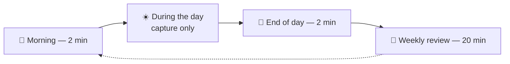

### The daily rhythm

| Moment | Duration | What happens |
|---|---|---|
| **Morning** | 2 min | Open the "Due in 7 days" filter (overdue included). Pick the notebook's Big 3 — use yesterday's draft line if there is one. |
| **During the day** | — | Capture: an action → task list, information → Notes (one line, team first). The notebook stays open for thinking and drawing. |
| **End of day** | 2 min | Close the notebook's symbols (`✓`, `→`, `✕`). Anything marked `✕` gets cleared from the task list too. Optionally, draft tomorrow's first item. |

### The weekly review: one meeting with yourself

**When:** the same slot every week (Friday afternoon works well), 20 minutes, phone away. It runs from a **single recurring task** in the task list whose description *is* the agenda — copy the block below into it.

| # | Item | What you do | Min |
|---|---|---|---|
| 1 | **Tasks** | Open *Due in 7 days*. Overdue: do, reschedule or delete. **Capacity check:** more than about 15 tasks? Move the least important to a later week *before* adding anything new | 3 |
| 2 | **Follow-ups** | Open *Follow-ups*. Send the nudges that are due, set the next date, close what arrived | 2 |
| 3 | **Projects** | For each `Now` project: update its Status, search its name in the task list, confirm at least one open task. If none: add the next action, or set `On Hold` / `Done` | 3 |
| 4 | **New notes** | Open *No team*. One fate per row: Keep / Act / Toss / Graduate (Part 3) | 4 |
| 5 | **Old notes** | Open *Review* (notes 30–37 days old). One fate per row: File / Leave / Archive (Part 3) | 3 |
| 6 | **Next week** | Look at the calendar and *Due in 7 days*. Choose the one thing for a **protected focus block of 30+ minutes** and book it | 3 |
| 7 | **Close** | Anything still loose, on paper or in your head → task list or Notes | 1 |
| | | **Total** | **19** |

**Copy-paste for the task description:**

```
Weekly review — 20 min, phone away
1. Tasks (3): filter "Due in 7 days". Overdue: do / reschedule / delete. More than ~15? Push the least important out first.
2. Follow-ups (2): filter "Follow-ups". Send due nudges, set next date, close what arrived.
3. Projects (3): each project in "Now": update Status, search its name in Todoist, at least one open task? If not: add the next action or set On Hold / Done.
4. New notes (4): Notes > "No team". Keep (set Team) / Act (task) / Toss (delete) / Graduate (database row).
5. Old notes (3): Notes > "Review". File into its page / Leave / Archive (tick Archived).
6. Next week (3): calendar + "Due in 7 days". Pick ONE thing for a 30+ min focus block and book it.
7. Close (1): anything loose (paper, head) goes to Todoist or Notes.
Bad week: do 1 and 2 only (5 min). Skipped a week: don't catch up.
```

**Rules that keep it alive**

| Situation | Do |
|---|---|
| Normal week | The seven items (about 20 minutes) |
| **Bad week** | Minimum review, 5 minutes: items 1 and 2 only. Everything else waits one week |
| **Skipped a week** | Don't catch up. Run the normal review next time; if *No team* passes ~30 rows, run item 4 twice that week |
| **Takes too long** | Cut, don't extend. The review is the part of GTD people most often drop, and it gets dropped when it grows [1][45] |
| **Trigger** | A recurring task, fixed time. Pair it with something you like (coffee) [45] |
| **Protected block** | At least 30 minutes, sized to the task and movable when the week changes. A light borrow from time blocking, not scheduling every hour [46] |

### Later: add-ons for slower things

Do **not** start with these. Once the weekly review is a habit and you have created the corresponding database, attach the checks to specific weeks as extra lines of the same agenda. The task is the same, only the description grows.

| What | When | What happens |
|---|---|---|
| **Risks and Debt** *(optional database)* | First review of the month | Open, high-impact items: each has a next action in the task list, or is `Accepted`, or `Closed` |
| **Metrics I watch** *(page)* | First review of the month | Update the *last reading* column |
| **Service Catalog** *(optional database)* | First review of the month | Sort by `Last edited time`, oldest first; open a few entries. Check the view *Critical and SLO = Missing* |
| **Reliability review** *(Meetings row)* | First review of the month | Read the dashboards for systems with a `Defined` SLO; add one dated entry |
| **Decisions, Technology Radar** *(optional databases)* | First review of the quarter | `Proposed` and low-confidence decisions; what moved ring, what is stale |
| **Roadmap** *(optional database)* | First review of the quarter | Recheck anything still on a rough `Horizon` |
| **Ideas** *(Notes view)* | First review of the quarter | Skim, oldest first; drop what is not going anywhere. This keeps the Ideas view from becoming a graveyard |

---

## Part 11 — General principles for structuring any new database

1. **Few properties** — only the ones that answer a real filtering or sorting question.
2. **The right type for each field** — Select for fixed values; Date only for real dates; Relation only when there's a genuine two-way rollup to gain.
3. **The title identifies the row on its own** — without needing to open the page.
4. **Rich content lives in the page body**, never in a property — properties are for filtering, not for narrating.
5. **Two or three views cover almost everything** — one filtered for daily use, one grouped for a bird's-eye view, one unfiltered for the rare full audit.
6. **Let Notion's built-in Created time and Last edited time do free work.** Both cost nothing to add and nothing to maintain — Notion fills them in automatically, with no discipline required. Add **Created time** wherever "how long has this existed" is useful context — Projects, Roadmap, Notes and the optional databases all benefit from it. Prefer **Last edited time** over a manual "Last updated" field whenever editing the page *is* the update, as with Meetings and 1:1 Meetings. Reserve a manual date field for a signal Notion genuinely can't infer on its own — "a person deliberately confirmed this is still accurate" is a different fact from "something changed," and only the first one is worth paying for with a field of its own. Most of the time, though, Last edited time is close enough on its own: none of the databases in this system carry a separate manual review date, because the discipline of keeping one up to date usually costs more than the extra precision is worth.
7. **Before adding anything — a database, a Relation, even a single property — name the concrete question it answers today.** Not a question you might have someday; one you actually have right now. If you can't name it, the thing you're about to add is decoration, not structure, no matter how small it looks. This is the golden rule from Part 4 applied one level down, to individual fields and not just whole databases — it's the same discipline that keeps Todoist free of Labels and keeps Roadmap's `Year` optional (Part 6) instead of forced.
8. **A kind of thing has one home.** Tasks never live in Notion; knowledge never lives in Todoist. And two databases with the same shape are one database — that is how Someday / Ideas became a tag.
9. **If the real data lives in another tool, store the definition and the link, not the data.** Metrics, incidents, tickets and SLO numbers stay where they are produced; Notion holds what they mean and where to look.
10. **New kinds of information climb a ladder.** A note, then a tag and a filtered view, then a database — one rung at a time, with the rule of three as the first trigger (Part 5).

If the rows in a database start needing very different fields from one another, that's a sign it should be two databases — or not a database at all.

---

## Part 12 — Seeing it filled in

The worked example that used to live here is now a separate file, **`example-workspace.md`**, so this document stays about the system and not about one company's data. It shows, with dummy data for a fictional company:

- the sidebar, a week of Notes and the Friday triage;
- the six core databases filled in, plus the optional ones (Service Catalog, Roadmap, Decisions, Risks and Debt, Technology Radar) as examples of what you *could* add later;
- Todoist with tasks, subtasks and the three filters; a notebook page; a full week day by day.

Treat the optional databases there as samples of the structures in Part 9 — none of them is required.

---

## Appendix — Evidence and sources

**How these were gathered.** Summaries and write-ups of the books were read rather than the books themselves (GTD, *Building a Second Brain*, *How to Take Smart Notes*, Larson's work), as were descriptions and summaries of Notion videos rather than the full videos. Reddit threads couldn't be retrieved. Limits and features of Todoist and Notion were checked against their help pages where possible and against third-party write-ups otherwise; both products change often, so verify before relying on a limit.

**Method and research**

| # | Source | Used for |
|---|---|---|
| [1] | GTD overview — https://developers.fabric.so/learn/getting-things-done | Capture points, weekly review as critical success factor and failure point |
| [2] | GTD forum: the two-minute rule belongs to the clarify step — https://forum.gettingthingsdone.com/posts/149872 | Act outcome in triage |
| [3] | GTD forum: projects with waiting-fors — https://forum.gettingthingsdone.com/threads/projects-with-waiting-fors.5708 | Follow-up as a dated next action |
| [4] | Waiting For list template — https://super-productivity.com/blog/gtd-waiting-for-list/ | Waiting For vs next action |
| [5] | Forte Labs: Building a Second Brain overview — https://fortelabs.com/basboverview/ | CODE; action items to the task manager, notes to the notes app |
| [6] | BASB book summary — https://mmapped.blog/posts/16-building-a-second-brain | CODE, PARA |
| [7] | Second brain glossary — https://weekplan.net/academy/glossary/second-brain/ | One trusted inbox; organize only when retrieval fails |
| [8] | *How to Take Smart Notes* summary — https://www.ybrikman.com/blog/2023/08/10/how-to-take-smart-notes/ | Fleeting notes must be processed |
| [9] | IBM Research: *Am I wasting my time organizing email?* — https://researcher.ibm.com/publications/am-i-wasting-my-time-organizing-email-a-study-of-email-refinding | Folders vs search (345 users, 85,000 actions) |
| [10] | Caveat on the study's headline numbers — https://www.getmailbird.com/organize-email-inbox/ | Per-operation vs end-to-end timings |
| [11] | Evan Hahn: only organize when you cannot search — https://evanhahn.com/only-organize-when-you-cannot-search | Search before structure |
| [24] | Pat Kua: top tools for engineering managers — https://www.patkua.com/blog/top-tools-for-engineering-managers/ | Effective managers take and review notes |

**Engineering artefacts**

| # | Source | Used for |
|---|---|---|
| [12] | Thoughtworks: build your own Technology Radar — https://www.thoughtworks.com/en-ca/insights/blog/build-your-own-technology-radar | Quadrants, rings, litmus test |
| [13] | Technology Radar and ADRs — https://concepts.dsebastien.net/concept/technology-radar/ | Radar positions, decisions explain |
| [14] | Martin Fowler: Architecture Decision Record — https://www.martinfowler.com/bliki/ArchitectureDecisionRecord.html | Status, consequences, confidence, supersession |
| [15] | Nygard's ADR template — https://docs.clan.lol/decisions/template | Title, status, context, decision, consequences |
| [16] | Google SRE Workbook: implementing SLOs — https://sre.google/workbook/implementing-slos/ | SLI, SLO, error budget |
| [17] | SRE book notes on SLOs — https://dev.to/bitmaybewise/sre-book-notes-service-level-objectives-5aom | Keep SLOs few; defend the ones you pick |
| [18] | RAID in project management — https://www.ppm.express/blog/what-is-raid-in-project-management | Fields differ per type |
| [19] | RAID log template — https://affine.pro/blog/raid-log | One table with a category column |
| [20] | Technical debt register — https://routine.co/blog/posts/ai-technical-debt-prioritize | Track only what you will act on |
| [21] | Will Larson: paying technical debt at scale — https://www.infoq.com/presentations/stripe-technical-debt | Migrations as the mechanism |
| [22] | DORA metrics — https://www.checklyhq.com/learn/incidents/dora-metrics | Four key metrics; comparison caveat |
| [23] | Blameless postmortem template — https://oneuptime.com/blog/post/2026-07-30-blameless-postmortem-template/view | Postmortem structure and repository |

**Tools**

| # | Source | Used for |
|---|---|---|
| [25] | Todoist usage limits — https://todoist.com/help/articles/usage-limits-in-todoist | 5 free projects, 300 active tasks per project |
| [26] | Todoist filters — https://todoist.com/help/articles/how-to-best-use-filters | `search:` syntax; filter limits |
| [27] | Todoist free plan limits — https://www.usecarly.com/blog/todoist-free-plan-limits/ | 3 filters; reminders |
| [28] | Todoist text formatting — https://todoist.com/help/articles/how-to-format-text-e5dHw9 | Links in tasks; not on mobile |
| [29] | Notion: database load times and limits — https://www.notion.com/help/optimize-database-load-times-and-performance | 250,000 rows |
| [30] | Notion: database buttons — https://www.notion.com/help/database-buttons | Buttons on all plans; some actions paid |
| [31] | Notion: mobile widgets — https://www.notion.com/help/mobile-widgets | Widgets to a page or database |
| [32] | Notion: navigate with the sidebar — https://www.notion.com/help/navigate-with-the-sidebar | Favorites, collapsing sections |
| [33] | Notion block limit — https://fast.io/resources/notion-block-limit/ | Free plan: unlimited blocks for one owner |
| [34] | Notion quick notes with iPhone Shortcuts — https://bennybuildsit.com/blog/how-to-take-notion-quick-notes-iphone-shortcuts | Shortcut capture path |
| [35] | Default database templates — https://www.usecarly.com/blog/how-to-add-template-to-notion | Setting a default template |
| [36] | GTD with Asana: rename the task instead of subtasks — https://forum.asana.com/t/dependencies-bringing-child-tasks-to-my-tasks-once-parent-task-is-completed/49596/19 | Subtasks only for non-predictable steps |
| [40] | Todoist review — https://crm.org/news/todoist-review | Free plan includes subtasks |
| [41] | Notion Academy: organized workspace best practices (mirror) — https://careers.codedamn.com/en-gb/help/notion-academy/lesson/organized-workspace-best-practices | Minimal sidebar; prune favorites |
| [42] | Notion starred pages — https://www.sparxno.com/blog/notion-starred-favorites | Keep favorites short |
| [43] | Notion: team sidebar guide — https://www.notion.com/de/help/guides/the-best-way-to-set-up-your-teams-sidebar-for-clear-organization | Rotate favorites |
| [45] | Todoist: how to make GTD stick (weekly review, overcommitting, saying no) — https://www.todoist.com/inspiration/gtd-tips | Review skipped; capacity check |
| [46] | GTD Forum: Time Blocking and GTD — https://forum.gettingthingsdone.com/threads/time-blocking-and-gtd.18942/post-149343 | Light time blocking vs every-hour blocking |
| [47] | Notion databases can now have multiple data sources (a view shows a single source) — https://thomasjfrank.com/notion-databases-can-now-have-multiple-data-sources/ | No cross-database view |
| [48] | Jeff Su: master 80% of Notion (linked views in templates) — https://www.jeffsu.org/master-80-of-notion-with-this-one-feature/ | Filtered views in a template |
| [49] | Notion dashboards (global filters; Business plan and above) — https://matthiasfrank.de/en/notion-dashboards-database-view/ | Dashboard filters |
| [50] | Notion: links and backlinks — https://www.notion.com/en-gb/help/create-links-and-backlinks | Backlinks from @-mentions |
| [51] | How to combine databases in Notion — https://www.bardeen.ai/answers/how-to-combine-databases-in-notion | No native union |
| [44] | Free task managers compared — https://super-productivity.com/blog/best-free-online-task-managers-2026/ | Free Todoist includes recurring tasks |

**Background reading** (videos, read as summaries): Notion quick-capture workflow, KB Creative — https://m.youtube.com/watch?v=HzvWHZvIwPSY [37]; Thomas Frank, *The Ultimate Second Brain Setup in Notion* — https://www.recall.it/summary/thomas-frank-explains/the-ultimate-second-brain-setup-in-notion [38]; Tiago Forte's official Notion setup — https://podwise.ai/episodes/7271854 [39].

### Things to verify in-app

None of these blocks the system; each has a fallback.

| # | To verify | Fallback |
|---|---|---|
| 1 | A project name in brackets at the end of a Todoist title is found by the search bar and by `search:` | Drop the brackets; keep the name as a plain word |
| 2 | Subtasks accept their own due date on the free plan | Put the date on the parent task |
| 3 | The Notion button action "Add page to" works on the free plan | Widget to the Notes database → **New** |
| 4 | The Notion "add page to database" Shortcuts action still exists (iPhone only) | Notion widget → **New** |
| 5 | The Android Page widget opens the Notes database directly (no quick-note widget action is documented) | Favorites widget → Notes → **New** |
| 6 | "Move to" a different database keeps property values | Copy the title and paste it as a new row |
| 8 | Notion search matches only whole words ("tes" did not find "test") — whether a "Title contains" view filter matches part of a word | Use whole-word titles; project names as ordinary words; filter the view by tag or team |
| 9 | The linked-view filter on a template (Team contains the template page) works in your Notion version, and whether a "this page" filter option exists; whether existing team pages need the views copied by hand | Add the views to each team page and edit the filter once per team |
| 7 | Whether free Todoist notifies at a task's due time (newer sources say yes, older say no) | Check in the app; rely on the *Due in 7 days* filter |

